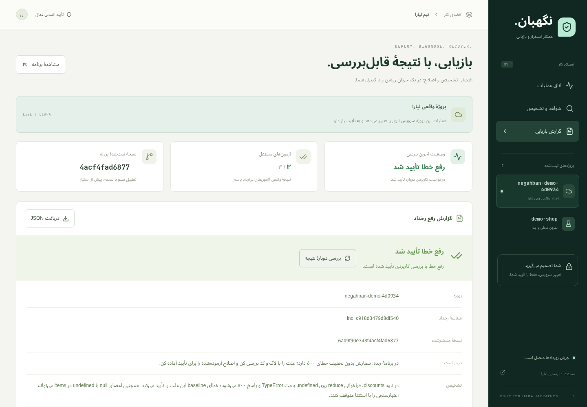

**نگهبان — همکار استقرار و بازیابی روی لیارا**

نگهبان یک MVP محلی برای بررسی رخداد، آماده‌سازی اصلاح کد، انتشار با تأیید انسان و بررسی نتیجه است. برنامهٔ هدف روی لیارا اجرا می‌شود؛ داشبورد، Codex و محیط آزمون روی ماشین توسعه اجرا می‌شوند.

[ویدئوی فارسی پنج‌دقیقه‌ای](submission/DEMO.fa.mp4) · [بستهٔ کامل تحویل](submission/negahban-submission.zip) · [شواهد اجرای واقعی](submission/evidence/live-recovery-report.json)

مخزن پروژه: [Agentic-AI-Hackathon-Liara-Challenge](https://github.com/Shahin-Kohzadpour/Agentic-AI-Hackathon-Liara-Challenge). فایل‌های آمادهٔ ارائه در پوشهٔ `submission/` قرار دارند.



**دامنهٔ واقعی این نسخه**

این نسخه برای برنامهٔ نمونهٔ Node.js همین مخزن ساخته و آزموده شده است. تابع خلاصهٔ سفارش، قرارداد پاسخ و آزمون‌های مستقل مشخص دارد. اتصال به مخزن دلخواه، پشتیبانی عمومی از همهٔ پروژه‌ها، پایش شبانه‌روزی و رفع هر نوع رخداد ادعا نمی‌شود. اصلاح کد را Codex واقعاً تولید می‌کند؛ در مسیر محصول patch ذخیره‌شده یا پاسخ نمایشی جای مدل نمی‌نشیند.

در نمونهٔ معیوب، درخواست بدون فیلد اختیاری `discounts` خطای ۵۰۰ می‌دهد، ولی `/healthz` سالم است. نگهبان شواهد را دریافت می‌کند، شکست را در محیط جدا بازتولید می‌کند، اصلاح مدل را با قرارداد محدود تابع اعتبارسنجی می‌کند، هفت آزمون مستقل اجرا می‌کند و انتشار را برای تأیید آماده می‌کند. بعد از تأیید، همان snapshot منتشر و درخواست واقعی دوباره بررسی می‌شود.

**راه‌اندازی**

پیش‌نیازها: Linux، Node.js نسخهٔ ۲۲٫۱۶ یا جدیدتر، npm، `bubblewrap`، و Codex CLI نصب‌شده و واردشده به حساب. برای بررسی مرورگر، Chromium محلی هم لازم است. Docker پیش‌نیاز این نسخه نیست. در نبود محیط جدا، اجرای کد متوقف می‌شود.

این اجرا با Codex CLI نسخهٔ `0.163.0` بررسی شده است. wrapper از گزینه‌های همین نسخه برای حذف تنظیمات ابزارهای میزبان استفاده می‌کند؛ نسخهٔ قدیمی‌تر بدون بررسی سازگاری توصیه نمی‌شود.

```bash
npm ci
cp .env.example .env
chmod 600 .env
npm run build
npm run dev
```

در ترمینال دیگری اجرا کنید:

```bash
npm run access
```

لینک خصوصی خروجی را در مرورگر باز کنید. کلید fragment پس از ورود از نشانی حذف می‌شود. این لینک اختیار تأیید عملیات را دارد و نباید در prompt مدل، issue، ویدئو یا مخزن عمومی قرار گیرد. داشبورد فقط روی `127.0.0.1` گوش می‌دهد.

در `.env` محلی، `LIARA_API_TOKEN` و `LIARA_TEAM_ID` را تنظیم کنید. برای اتصال به نمونهٔ مستقرشده، `LIARA_PROJECT` را نیز بدهید. اطلاعات ورود حساب و کلیدهای واقعی در مخزن قرار نمی‌گیرند. برای دامنهٔ سفارشی نمونه، مدیر می‌تواند `LIARA_APP_URL` را تنظیم کند؛ عامل امکان انتخاب URL دلخواه ندارد.

**معماری کوتاه**

```text
داشبورد React ───────┐
                    ├─ Fastify → هستهٔ عملیات → تأیید و قفل پروژه → API / CLI لیارا
کلاینت MCP → STDIO ──┘                  │
                           Codex SDK → اصلاح JSON نوع‌دار
                                      │
                        بررسی قرارداد منبع → snapshot → bubblewrap → verifier مستقل
```

وضعیت رخداد، رویدادها و تأییدها در SQLite ثبت می‌شود. به‌روزرسانی داشبورد از SSE می‌آید. ابزارهای MCP و رابط وب از یک هسته استفاده می‌کنند. مدل برای تولید اصلاح، سورس و شواهد پالایش‌شده را می‌گیرد و اختیار shell، MCP، انتشار یا تأیید ندارد. فرمان‌های Codex با تنظیم مستقل از ابزارها و pluginهای کاربر اجرا می‌شوند.

اجرای کد نمونه داخل namespace جدا، با شبکهٔ جدا، منبع فقط‌خواندنی، محیط متغیرهای خالی، سقف زمان و سقف خروجی انجام می‌شود. heap جاوااسکریپت نیز محدود است. این کنترل‌ها جای sandbox چندمستأجری با سهمیهٔ کامل سیستم‌عامل را نمی‌گیرند؛ دامنهٔ اجرا به نمونهٔ ثبت‌شده محدود است.

**اتصال واقعی به لیارا**

- مرجع API: [developers.liara.ir](https://developers.liara.ir/).
- احراز هویت Bearer با درخواست فقط‌خواندنی در حساب تیم آزموده شده است. نمونه‌های بعضی صفحات مستندات پیشوند را نشان نمی‌دهند؛ رفتار CLI رسمی نیز Bearer است.
- شناسهٔ تیم در `teamID` درخواست‌های API و `--team-id` در CLI اعمال می‌شود.
- API برای وضعیت، لاگ، رویداد، نسخه، CPU و حافظه استفاده می‌شود. برای منابع، پارامتر اجباری `since` ارسال می‌شود. دادهٔ خالی یا واحد نامشخص به‌صورت صفر ساخته نمی‌شود. در حساب نمونه، دریافت CPU و حافظه با این پارامتر موفق بوده است.
- endpoint قدیمی `v1/.../logs` در این زیرساخت صرفاً پیام ارتقای کلاینت برمی‌گرداند؛ آن پیام لاگ برنامه نیست. مطابق پیاده‌سازی CLI رسمی، لاگ واقعی از `v2/projects/{name}/logs` با `start`، `direction`، `last_lines` و فیلتر `releaseId` دریافت و متن آن باز می‌شود.
- [CLI رسمی](https://docs.liara.ir/references/cli/deploy-app/) برای بسته‌بندی و استقرار از snapshot ثابت استفاده می‌شود. کلید در account file موقت با مجوز `0600` قرار می‌گیرد و بعد پاک می‌شود؛ کلید در argv فرمان نیست.
- در snapshot فایل‌های منبع `0444` هستند تا کاربر غیرریشهٔ runtime بتواند آن‌ها را بخواند. در آزمایش اولیه، با وجود READY، پاسخ عمومی HTTP 502 بود. پس از یکسان‌سازی مجوز فایل‌ها و بازاستقرار همان محتوا، درخواست کاربردی قابل‌بررسی شد. پیام ارتقای کلاینت شاهد علت خرابی runtime نبود؛ علت قطعی اولین 502 فقط از آن پیام تعیین نشده است. آزمون رگرسیون مانع موفقیت کاذب در حالت READY همراه با 502 است.
- آماده‌بودن release تنها یکی از شواهد است؛ موفقیت برنامه با درخواست HTTP و قرارداد پاسخ بررسی می‌شود.

برای بررسی فقط‌خواندنی اتصال:

```bash
npm run spike
```

گزارش پالایش‌شده در `artifacts/liara-spike.json` ذخیره می‌شود. این فرمان منبع ابری ایجاد نمی‌کند.

**اولین استقرار نمونه**

فرمان زیر فقط یک پیشنهاد شامل نام برنامه، تیم، پلن، قیمت دریافت‌شده و hash سورس می‌سازد:

```bash
node --env-file=.env --import tsx scripts/provision.ts
```

پس از بررسی و تأیید صریح این پیشنهاد، مالک محیط می‌تواند اجرا کند:

```bash
node --env-file=.env --import tsx scripts/provision.ts --apply
```

این فرمان شبکه و برنامهٔ اختصاصی نمونه را می‌سازد و همان سورس را منتشر می‌کند. پرداخت و شارژ حساب خودکار نیست. در خطا یا timeout پیش از تکرار، وضعیت حساب بررسی شود؛ `--apply` فرمان مناسب اجرای کورکورانه در CI نیست. نمونهٔ آغازین عمداً باگ محدود دارد؛ موفقیت راه‌اندازی آن یعنی درخواست عادی و validation درست‌اند و خطای هدف به‌صورت مشخص بازتولید می‌شود، نه این‌که رخداد رفع شده است.

**تعامل کاربر**

۱. پروژهٔ محلی یا واقعی لیارا را انتخاب کنید.
۲. مشکل را بنویسید و «بررسی و آماده‌سازی اصلاح» را بزنید.
۳. شواهد، تشخیص، diff و نتیجهٔ آزمون را بررسی کنید.
۴. کارت انتشار را تأیید یا رد کنید. بدون تأیید، سرویس تغییر نمی‌کند.
۵. پس از استقرار، گزارش بررسی کاربردی و release واقعی را ببینید و JSON را دریافت کنید.

برای مشاهدهٔ خود مسئله، «مشاهدهٔ برنامه» یک صفحهٔ ساده باز می‌کند که درخواست را به اجرای محلی یا برنامهٔ واقعی منتخب می‌فرستد. مسیر واقعی برنامهٔ ابری `/api/summary` است. سرور نمونهٔ ابری در `/` صفحهٔ فروشگاه کامل ندارد.

**تأیید و ایمنی عملیات**

تأیید به action مشخص، پروژه، revision پایه، release زنده، hash snapshot و انقضا متصل است و یک‌بار مصرف می‌شود. تغییر نسخه یا منبع، انتشار را مسدود می‌کند. تکرار عمل موفق انتشار تازه ایجاد نمی‌کند. عملیات هم‌زمان یک پروژه قفل می‌شود. پس از توقف هنگام یک عمل خارجی، نتیجه نامشخص ثبت می‌شود و اجرای خودکار دوباره انجام نمی‌شود.

نشست انسانی و capability ابزار MCP جدا هستند. نشست انسانی با کلید خصوصی، cookie فقط HTTP و SameSite، بررسی Origin/Host و CSRF محافظت می‌شود. ابزار MCP حتی با Origin جعلی نمی‌تواند تأیید ثبت کند. سرور عمومی، چندکاربره و احراز هویت سازمانی در این نسخه ارائه نمی‌شود.

لاگ، گزارش کاربر و سورس ورودی غیرقابل‌اعتماد هستند. مقادیر کلید شناخته‌شده و فیلدهای حساس پالایش می‌شوند. مدل از ابزارهای میزبان استفاده نمی‌کند؛ اصلاح تولیدشده فقط در قرارداد محدود تابع نمونه پذیرفته و سپس در محیط جدا آزموده می‌شود. این نسخه تضمین حذف همهٔ انواع secret ناشناخته از هر متن دلخواه را نمی‌دهد.

ری‌استارت برای پروژهٔ واقعی پیشنهاد قابل‌تأیید دارد. تغییر Env، resize، حذف منابع و migration در رابط این نسخه فعال نشده‌اند. بازاستقرار منبع قبلی تنها وقتی پیشنهاد می‌شود که از آزمون مستقل عبور کند. rollback مستقیم با API اختصاصی و بازگردانی دادهٔ دیتابیس ادعا نمی‌شود. بازگشت خودکار بدون تأیید نیز وجود ندارد.

پس از READY ممکن است پاسخ عمومی هنوز پایدار نشده باشد. کنترل‌کننده با سقف تلاش مشخص، موفقیت متوالی روی همان release را بررسی می‌کند. اگر بررسی شکست بخورد، رخداد رفع‌شده نیست. دکمهٔ «بررسی دوبارهٔ نتیجه» فقط نسخهٔ موجود را دوباره می‌سنجد و استقرار تازه انجام نمی‌دهد. اجرای دو سرور مالک روی یک فضای داده نیز مسدود است.

**اتصال MCP**

ابتدا سرور وب را اجرا کنید. سپس در کلاینت MCP یک سرور STDIO با command و args زیر ثبت کنید:

```json
{
  "command": "npm",
  "args": ["--prefix", "/absolute/path/to/liara-sre-agent", "run", "--silent", "mcp"]
}
```

ابزارها: `liara_projects`، `liara_diagnostics`، `incident_start`، `deployment_prepare`، `deployment_apply` و `incident_report`. ابزار تأیید وجود ندارد. `deployment_apply` فقط action از قبل تأییدشده را اجرا می‌کند. مدل رمز حساب یا API key را دریافت نمی‌کند.

آزمون اتصال یک کلاینت واقعی MCP:

```bash
npm run test:mcp
```

فرمان توسعهٔ زیر فقط روی نمونهٔ ثبت‌شدهٔ واقعی، پیشنهاد اصلاح می‌سازد و بررسی می‌کند MCP نتواند آن را بدون تأیید منتشر کند:

```bash
npm run test:mcp -- --prepare-live
```

**بررسی کیفیت**

```bash
npm test
npm run build
npm run test:browser
```

آزمون‌های backend از عامل تست تزریق‌شده استفاده می‌کنند تا کنترل مجوز، شکست و قرارداد مستقل را تکرارپذیر بررسی کنند. مسیر محصول هرگز به این عامل تست fallback نمی‌کند. `test:browser` هنگام نیاز به اصلاح واقعاً Codex را فراخوانی می‌کند و تأیید مرورگری آن فقط برای تمرین محلی است. اگر نمونه قبلاً اصلاح شده باشد، گزارش مرورگر این موضوع را ثبت می‌کند؛ برای اجرای تازه، ابتدا نسخهٔ معیوب محلی را با کارت جدا آماده و تأیید کنید.

شواهد تولیدشده زیر `artifacts/` هستند: گزارش API، نتیجهٔ مرورگر، screenshotها، گزارش MCP، پیشنهاد اصلاح و در صورت ضبط، ویدئو. `.data/` شامل snapshotها، SQLite و کلیدهای خصوصی محلی است و نباید منتشر شود. گزارش JSON قابل‌دریافت از داشبورد برای ارائهٔ شواهد مناسب است، ولی قبل از انتشار عمومی باید مرور شود.

**دمو و تحویل**

[متن روایت پنج‌دقیقه‌ای](docs/DEMO.fa.md)، [معماری و قرارداد عملیات](docs/ARCHITECTURE.fa.md) و [راهبرد اولیهٔ هکاتون](docs/STRATEGY.fa.md) در مخزن هستند. راهبرد اولیه دامنهٔ پیشنهادی گسترده‌تری دارد؛ دامنهٔ پیاده‌سازی‌شده و محدودیت‌های معتبر در همین README و گزارش اعتبارسنجی ثبت شده‌اند. نتیجهٔ تست، source hash و release واقعی را نشان دهید؛ از بیان Uptime، MTTR یا امتیاز تضمینی بدون اندازه‌گیری خودداری کنید.

[گزارش اعتبارسنجی واقعی](docs/VALIDATION.fa.md) جزئیات نتیجه و محدودیت‌ها را دارد. خروجی روایت‌شدهٔ فارسی `artifacts/DEMO.fa.mp4` به مدت حدود پنج دقیقه از تصاویر اجرای واقعی ساخته شده است؛ صدا مصنوعی است و متن آن در `docs/NARRATION.fa.json` قرار دارد. `artifacts/LIVE-RUN.silent.mp4` فیلم خام دو بخش اجرا را نگه می‌دارد. ارائهٔ روایت‌شده را اجرای زندهٔ پیوسته معرفی نکنید. [راهنمای بستهٔ تحویل](docs/SUBMISSION.fa.md) فایل‌ها و مراحل ارائه را مشخص می‌کند.

تولید اختیاری صدا با [edge-tts](https://github.com/rany2/edge-tts) فقط متن عمومی روایت را به سرویس گفتار می‌فرستد؛ قابلیت صوتی داخل محصول یا وابستگی runtime سرور نیست. ابزارهای ویدئو علاوه بر Chromium، به FFmpeg و بستهٔ FFmpeg مخصوص Playwright نیاز دارند.
