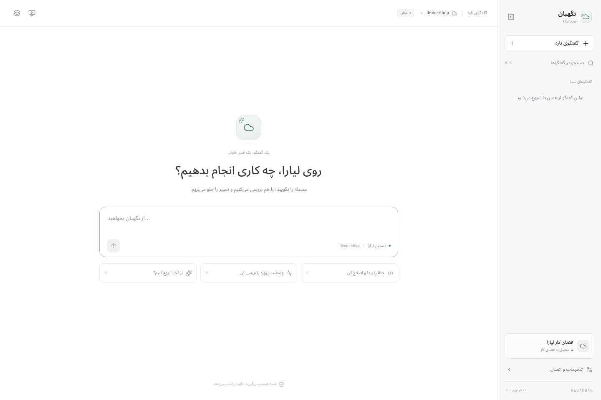
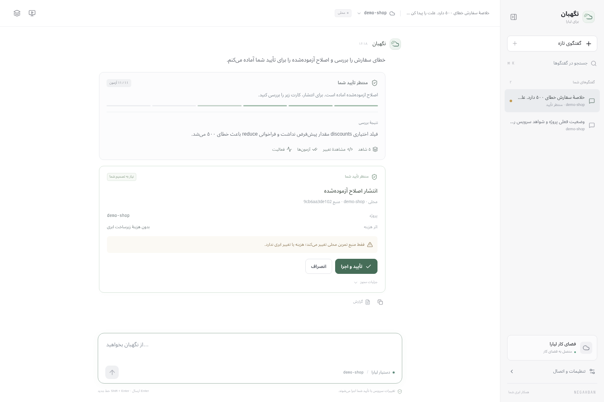

<a name="top"></a>
# نگهبان

**همکار استقرار و بازیابی روی لیارا.** یک رخداد واقعی را می‌گیرد، شواهد سرویس را جمع می‌کند، خطا را در محیط جدا بازتولید می‌کند، اصلاح را Codex می‌نویسد، آن را با آزمون‌های مستقل می‌سنجد و تنها پس از تأیید انسان منتشر می‌کند. موفقیت هم با درخواست واقعی روی همان release اثبات می‌شود، نه با پیام «آماده».

[دموی فارسی پنج‌دقیقه‌ای](submission/DEMO.fa.mp4) · [بستهٔ کامل تحویل](submission/negahban-submission.zip) · [گزارش نتیجهٔ واقعی](submission/evidence/live-recovery-report.json) · [گزارش بازبینی مستقل](docs/AUDIT.fa.md)



## فهرست

- [مسئله](#problem)
- [آنچه ساخته شده](#features)
- [چرخهٔ یک رخداد](#flow)
- [پیش‌نیازها](#requirements)
- [راه‌اندازی](#setup)
- [تنظیمات](#config)
- [اولین استقرار روی لیارا](#first-deploy)
- [رابط کاربری](#ui)
- [معماری](#architecture)
- [مرجع API محلی](#api)
- [اتصال MCP](#mcp)
- [مدل ایمنی و تأیید](#safety)
- [یکپارچگی با لیارا](#liara)
- [آزمون‌ها](#tests)
- [نتیجهٔ واقعی و شواهد](#results)
- [محدودیت‌ها](#limits)
- [عیب‌یابی](#troubleshooting)
- [ساختار مخزن](#layout)
- [اسناد](#docs)
- [تحویل و داوری](#delivery)

<a name="problem"></a>
## مسئله

استقرار روی لیارا برای کسی که DevOps نیست سه سؤال دارد: چه پلنی، چه دامنه‌ای، و وقتی خراب شد چه کنم؟ و برای تیم فنی یک سؤال سخت‌تر: وقتی سرویس خطا می‌دهد، چه کسی جرأت می‌کند بدون شاهد تغییرش دهد؟

در نمونهٔ این مخزن، `/healthz` سالم است ولی درخواست تجاری بدون فیلد اختیاری `discounts` با خطای ۵۰۰ پاسخ می‌دهد. این حالت عمدی است: سبز بودن health، `READY` بودن release و بالا بودن pod هیچ‌کدام ثابت نمی‌کنند که برنامه کار می‌کند.

نگهبان همین شکاف را پر می‌کند:

| بدون نگهبان | با نگهبان |
| --- | --- |
| «ری‌استارت کن، شاید درست شود» | شواهد، بازتولید، علت، تغییر محدود |
| تغییر مستقیم روی سرویس | پیشنهاد immutable + تأیید انسان + مجوز یک‌بارمصرف |
| «دیپلوی شد، فکر کنم اوکی است» | دو پاسخ صحیح متوالی روی همان release |
| لاگ و رمز در اختیار مدل | مدل بدون shell، بدون شبکه، بدون کلید، بدون اختیار انتشار |

<a name="features"></a>
## آنچه ساخته شده

- **تشخیص واقعی:** وضعیت، لاگ نسخهٔ دوم، رویدادها، تاریخچهٔ releaseها، CPU و حافظه از API لیارا؛ سپس بازتولید همان شکست در محیط جدا.
- **اصلاح واقعی:** Codex SDK یک ماژول کامل برمی‌گرداند؛ خروجی با یک اعتبارسنج محدود به تابع خالص نمونه پذیرفته می‌شود و در `bubblewrap` با شبکهٔ قطع و منبع فقط‌خواندنی آزموده می‌شود.
- **یازده آزمون مستقل:** هفت آزمون قرارداد و چهار حالت مرزی که در درخواست اولیه به مدل داده نشده‌اند (سرریز، عدد غیرایمن، تخفیف منفی، آیتم `null`).
- **تأیید انسانی واقعی:** کارت تأیید با ریسک، اثر هزینه، digest منبع، مهلت و ذکر یک‌بارمصرف بودن.
- **انتشار قابل‌اثبات:** CLI رسمی لیارا با همان snapshot؛ سپس بررسی قرارداد پاسخ روی دامنهٔ عمومی با تلاش محدود و شرط دو موفقیت متوالی.
- **اتاق زنده:** مرورگر واقعی Chromium روی کنسول لیارا، پخش MJPEG و گام‌های SSE؛ همان ایدهٔ Live View، برای کنسول لیارا.
- **گزارش قابل‌دریافت:** JSON شامل رخداد، شواهد، تشخیص، diff، آزمون، تصمیم، release و رویدادها.
- **MCP:** همان هسته در دسترس ایجنت کدنویسی، بدون هیچ ابزاری برای تأیید.

آنچه این نسخه **نیست**: پایش شبانه‌روزی، پشتیبانی عمومی از هر پروژه یا مخزن، تغییر Env، resize، حذف منبع، migration دیتابیس، rollback خودکار و رابط چندکاربره. جزئیات در [محدودیت‌ها](#limits).

<a name="flow"></a>
## چرخهٔ یک رخداد

```text
شکایت کاربر
   │
   ▼
collecting ── شواهد: وضعیت، لاگ، رویداد، release، CPU/RAM، درخواست واقعی
   │
   ▼
patching ──── بازتولید در محیط جدا → Codex → اعتبارسنج قرارداد تابع
   │
   ▼
testing ───── یازده آزمون مستقل روی snapshot تازه
   │
   ▼
awaiting_approval ── کارت تأیید: ریسک، هزینه، digest، مهلت، یک‌بارمصرف
   │                    │
   │ تأیید              │ رد
   ▼                    ▼
deploying            rejected (سرویس تغییر نمی‌کند)
   │
   ▼
verifying ─── درخواست اصلی + دو حالت تخفیف + ورودی نامعتبر + /healthz
   │            (۴۵ تلاش دوثانیه‌ای، حداقل دو پاسخ صحیح متوالی)
   ▼
resolved ──── گزارش بازیابی و JSON
```

هر شکست در هر مرحله به `failed` می‌رود و علت آن در داشبورد و گزارش ثبت می‌شود. حالت‌های `deploying` و `verifying` بعد از تأیید شروع می‌شوند و تا وقتی نتیجه روی همان release تأیید نشود، رخداد «رفع‌شده» نیست.

<a name="requirements"></a>
## پیش‌نیازها

| مورد | نسخه / توضیح |
| --- | --- |
| سیستم‌عامل | Linux (برای `bubblewrap` و اتاق زنده) |
| Node.js | ۲۲٫۱۶ یا جدیدتر (`node:sqlite` و `--env-file-if-exists`) |
| npm | همراه Node |
| bubblewrap | `/usr/bin/bwrap`؛ بدون آن اجرای کد متوقف می‌شود |
| Codex CLI | نصب‌شده و واردشده به حساب؛ SDK از CLI محلی استفاده می‌کند |
| Chromium | فقط برای `test:browser` و اتاق زنده |
| Liara CLI | از `node_modules` نصب می‌شود؛ نصب سراسری لازم نیست |
| Docker | لازم **نیست** |

این اجرا با Node.js ‎26.7.0، Codex SDK ‎0.163.0، Codex CLI ‎0.149.1 و Liara CLI ‎9.6.0 آزموده شده است. wrapper مخصوص Codex در `scripts/codex-bridge.mjs` گزینه‌های سازگار را اعمال می‌کند و ابزارهای میزبان را از worker حذف می‌کند؛ نسخهٔ قدیمی‌تر Codex بدون بررسی سازگاری توصیه نمی‌شود.

<a name="setup"></a>
## راه‌اندازی

```bash
npm ci
cp .env.example .env
chmod 600 .env
npm run build
npm run dev
```

سرور فقط روی `127.0.0.1:4317` گوش می‌دهد. در ترمینال دیگری:

```bash
npm run access
```

خروجی یک خط است:

```text
http://127.0.0.1:4317/#key=…
```

همان آدرس را کامل باز کنید. صفحه کلید را از fragment برمی‌دارد، آن را با یک session cookie جایگزین می‌کند و `#key=…` را از نوار نشانی پاک می‌کند. اگر ترجیح می‌دهید آدرس را کپی نکنید، همان کلید را در فیلد صفحهٔ ورود بچسبانید.

کلید ورود، اختیار تأیید عملیات است: در prompt مدل، issue، ویدئو یا مخزن عمومی قرار نگیرد. سرور خودش کلید را چاپ نمی‌کند تا فقط انسانِ پای همان ترمینال آن را ببیند.

<a name="config"></a>
## تنظیمات

همهٔ مقادیر در `.env` محلی می‌مانند (مجوز `0600`) و در مخزن قرار نمی‌گیرند.

| متغیر | لازم | کار |
| --- | --- | --- |
| `LIARA_API_TOKEN` | برای عملیات واقعی | کلید API لیارا |
| `LIARA_TEAM_ID` | برای عملیات واقعی | در `teamID` درخواست‌های API و `--team-id` در CLI اعمال می‌شود |
| `LIARA_PROJECT` | برای پروژهٔ زنده | نام برنامهٔ Node.js موجود یا تازه‌ساخته |
| `LIARA_APP_URL` | اختیاری | دامنهٔ سفارشی همان نمونه؛ باید HTTPS و بدون اطلاعات احراز هویت باشد |
| `LIARA_AUTH_SCHEME` | اختیاری | پیش‌فرض `bearer`؛ `raw` فقط پس از spike فقط‌خواندنی |
| `PORT` | اختیاری | پیش‌فرض ‎4317 |
| `CODEX_MODEL` | اختیاری | مدل جایگزین؛ خالی یعنی پیش‌فرض Codex محلی |
| `LIARA_CONSOLE_EMAIL` / `LIARA_CONSOLE_PASSWORD` | برای اتاق زنده | ورود به کنسول، فقط در فرایند سرور |
| `LIARA_TEAM_NAME` | اختیاری | نام تیم در کنسول، پیش‌فرض «لیارا» |
| `LIVE_CHROMIUM` | اختیاری | مسیر Chromium؛ پیش‌فرض `/usr/bin/chromium` |
| `LIVE_HEADLESS` | اختیاری | پیش‌فرض `true` |

بررسی فقط‌خواندنی اتصال، بدون ایجاد هیچ منبع ابری:

```bash
npm run spike
```

گزارش پالایش‌شده در `artifacts/liara-spike.json` ذخیره می‌شود.

<a name="first-deploy"></a>
## اولین استقرار روی لیارا

فرمان زیر فقط یک پیشنهاد می‌سازد: نام برنامه، تیم، پلن، قیمت واقعی دریافت‌شده از حساب و hash سورس.

```bash
node --env-file=.env --import tsx scripts/provision.ts
```

پس از بررسی و تأیید صریح مالک محیط:

```bash
node --env-file=.env --import tsx scripts/provision.ts --apply
```

`--apply` یک شبکه و یک برنامهٔ اختصاصی می‌سازد، پروژه را در SQLite ثبت می‌کند و همان سورس را منتشر می‌کند. پرداخت یا شارژ حساب خودکار نیست؛ نمونهٔ ساخته‌شده تا حذف دستی هزینهٔ ساعتی دارد.

نکته‌های عملی:

- پیش از `--apply` مقدار `LIARA_TEAM_ID` را بررسی کنید؛ اسکریپت تغییر تیم را رد می‌کند.
- اگر نام برنامه از قبل وجود داشته باشد، اسکریپت متوقف می‌شود؛ منابع نیمه‌ساخته را کورکورانه دوباره نسازید.
- این فرمان برای CI نیست. پس از timeout، اول وضعیت حساب را ببینید.
- نمونهٔ آغازین عمداً باگ محدود دارد؛ «موفق» بودن راه‌اندازی یعنی مسیرهای سالم و ورودی نامعتبر درست‌اند و خطای هدف قابل‌بازتولید است، نه اینکه رخداد رفع شده باشد.

<a name="ui"></a>
## رابط کاربری

رابط اصلی یک فضای کار گفتگو است: صفحهٔ شروع خلوت، کادر درخواست، تاریخچهٔ گفتگوها و پنل جزئیات که فقط هنگام نیاز باز می‌شود. گفتگوها و پیام‌ها در SQLite ذخیره می‌شوند؛ با تازه‌سازی صفحه، تاریخچه و وضعیت عملیات باقی می‌ماند. رخدادها و پیشنهادهای قبلی نیز به تاریخچه منتقل می‌شوند.

| بخش | رفتار |
| --- | --- |
| **گفتگوی تازه** | انتخاب پروژه از سربرگ؛ نوشتن درخواست یا استفاده از پیشنهادهای صفحهٔ شروع |
| **تاریخچه** | گفتگوهای مستقل با جستجو؛ هر گفتگو به پروژهٔ خودش متصل است |
| **پاسخ نگهبان** | پاسخ به سؤال‌ها با زمینهٔ گفتگو، دریافت شواهد، شروع اصلاح محدود یا آماده‌کردن پیشنهاد عملیات |
| **کارت تأیید** | پروژه، اثر هزینه، ریسک و مجوز؛ تأیید و رد داخل همان گفتگو انجام می‌شوند |
| **پنل جزئیات** | شواهد، diff، آزمون مستقل و بررسی پس از انتشار، فعالیت، نمای زنده و گزارش JSON |
| **موبایل** | تاریخچهٔ جمع‌شونده و پنل جزئیات تمام‌صفحه؛ کادر پیام در پایین گفتگو |

`Enter` پیام را می‌فرستد و `Shift + Enter` خط جدید می‌سازد. با `Ctrl/Cmd + K` جستجوی تاریخچه باز می‌شود. پیام‌های بعدی زمینهٔ همان گفتگو، رخداد و نتیجهٔ عملیات را دارند. سؤال‌هایی مثل «چرا این تغییر لازم بود؟» یا «هزینه‌اش چیست؟» به همان درخواست مربوط می‌شوند.

دریافت شواهد و اصلاح نمونه، پیشنهاد ری‌استارت پروژهٔ واقعی لیارا، پیشنهاد بازنشانی **معیوب** نمونه و بررسی دوبارهٔ نسخهٔ منتشرشده پشتیبانی می‌شوند. ایجاد منابع، تغییر پلن، Env، دامنه و ویرایش عمومی مخزن هنوز در دامنهٔ این نسخه نیستند. عامل گفتگو اختیار تأیید یا انتشار ندارد؛ درخواست تأیید در متن چت جای کلیک روی کارت را نمی‌گیرد.

بازکردن «نمای زنده» فقط پنل را نمایش می‌دهد. «شروع جلسهٔ زنده» مرورگر واقعی و بررسی سناریوی نمونه را آغاز می‌کند و رخدادش به گفتگو متصل می‌شود.




تصاویر از آزمون یکپارچهٔ محلی گرفته شده‌اند؛ در آن آزمون مدل fixture است و عملیات واقعی انتشار ابری انجام نمی‌شود.

<a name="architecture"></a>
## معماری

```text
┌────────────────────┐   ┌──────────────────────┐
│ داشبورد React      │   │ کلاینت MCP (STDIO)   │
│ session خصوصی+CSRF │   │ Bearer با capability │
└─────────┬──────────┘   └──────────┬───────────┘
          │                         │
          └──────────┬──────────────┘
                     ▼
              Fastify (127.0.0.1)
                     │
                     ▼
              هستهٔ عملیات (Core)
        قفل پروژه · ماشین حالت · تأیید
             │                    │
             ▼                    ▼
      API / CLI لیارا       Codex SDK (بدون ابزار)
             │                    │
             │                    ▼
             │          اعتبارسنج قرارداد تابع
             │                    │
             │                    ▼
             │        snapshot با digest ثابت
             │                    │
             │                    ▼
             │        bubblewrap: بدون شبکه، RO
             │                    │
             ▼                    ▼
      release واقعی ──────► بررسی قرارداد روی لبه
```

| فایل | مسئولیت |
| --- | --- |
| `src/core.ts` | مالک جریان رخداد، پیشنهاد عملیات، تأیید، انتشار، بررسی نتیجه |
| `src/store.ts` | SQLite: سندها، رویدادها، قفل پروژه؛ همهٔ تصمیم‌ها در تراکنش |
| `src/snapshots.ts` | هویت محتوای منبع (SHA-256) و بررسی دست‌نخورده بودن فایل‌ها |
| `src/agent.ts` | اصلاح محدود با Codex؛ خروجی JSON با schema، بدون ابزار و شبکه |
| `src/chat.ts` | گفتگوهای ماندگار، زمینهٔ پیام‌های بعدی و انتخاب عملیات محدود با Codex |
| `src/candidate.ts` | دامنهٔ JavaScript مجاز برای تابع نمونه |
| `src/runner.ts` | اجرای `bubblewrap` و مدیریت timeout/سقف خروجی |
| `src/liara.ts` | تنها واسط API و CLI لیارا |
| `src/server.ts` | نشست، CSRF، SSE، مسیرهای API و صفحهٔ آزمایشی |
| `src/live.ts` | Playwright + CDP screencast + گام‌های اتاق زنده |
| `src/mcp.ts` | آداپتر ابزارها؛ هیچ ابزار تأییدی ندارد |
| `src/owner.ts` | قفل مالک فضای داده؛ جلوگیری از دو سرور روی یک SQLite |
| `runner/verify.mjs` | آزمون مستقل، بیرون از snapshot و غیرقابل‌ویرایش توسط مدل |

وضعیت در SQLite (`documents`, `events`, `locks`) می‌ماند و داشبورد با SSE به‌روز می‌شود. اگر سرور هنگام یک عملیات خارجی متوقف شود، همان عملیات در راه‌اندازی بعدی «نامشخص/شکست‌خورده» ثبت می‌شود و خودکار تکرار نمی‌شود.

### قرارداد ActionPlan

| فیلد | نقش |
| --- | --- |
| `projectId`, `kind` | مقصد و عمل محدود (`deploy`, `restart`, `rollback`, `env` غیرفعال) |
| `snapshotId`, `digest` | منبع ثابت انتشار و اثر انگشت آن |
| `baseRevision`, `baseSnapshot`, `baseRelease` | پیش‌شرط‌های اجرا |
| `status`, `approvedAt`, `executedAt`, `expiresAt` | چرخهٔ تصمیم و مصرف |
| `risk`, `cost`, `summary` | توضیح قابل‌فهم برای انسان |
| `result` / `error` | نتیجهٔ واقعی یا علت شکست |

ساخت پیشنهاد هیچ تغییری در سرویس نمی‌دهد. اجرا دوباره همهٔ پیش‌شرط‌ها را بررسی می‌کند؛ محدودیت ظاهری UI یا annotation ابزار کافی نیست.

<a name="api"></a>
## مرجع API محلی

همهٔ مسیرها فقط از `Host: 127.0.0.1:<PORT>` پذیرفته می‌شوند. نوشتن‌ها علاوه بر آن به `Origin` درست نیاز دارند.

| متد و مسیر | دسترسی | کار |
| --- | --- | --- |
| `GET /api/health` | عمومی | بررسی زنده بودن داشبورد |
| `POST /api/session` | کلید ورود | ساخت session؛ کوکی `HttpOnly`, `SameSite=Strict`, ۸ ساعت |
| `GET /api/session` | session | بازگرداندن CSRF |
| `GET /api/state` | session | پروژه‌ها، گفتگوها، پیام‌ها، رخدادها، عملیات، رویدادها و قابلیت‌ها |
| `POST /api/conversations` | session + CSRF | ایجاد گفتگو برای پروژهٔ انتخاب‌شده |
| `POST /api/conversations/:id/messages` | session + CSRF | پیام با `requestId` برای جلوگیری از تکرار؛ پاسخ و عملیات به‌صورت غیرهم‌زمان |
| `GET /api/events` | session | جریان SSE با `Last-Event-ID` |
| `POST /api/diagnostics` | session + CSRF | دریافت تازهٔ شواهد |
| `POST /api/incidents` | session + CSRF | شروع بررسی رخداد |
| `POST /api/incidents/:id/verify` | session + CSRF | بررسی دوبارهٔ همان release، بدون استقرار تازه |
| `POST /api/actions/prepare` | session + CSRF | پیشنهاد انتشار، ری‌استارت، بازنشانی یا بازاستقرار |
| `POST /api/actions/:id/decision` | فقط session انسانی | تأیید یا رد؛ توکن ابزار حتی با Origin جعلی رد می‌شود |
| `GET /api/reports/:id` | session | دانلود JSON گزارش |
| `GET /api/live/state`, `POST /api/live/{start,stop,verify}` | session + CSRF | کنترل اتاق زنده |
| `GET /api/live/stream`, `/api/live/mjpeg` | session | SSE گام‌ها و فریم‌های تصویر |
| `POST /api/tools` | Bearer ابزار | همان شش قابلیت MCP |
| `GET /demo`, `/demo/healthz`, `POST /demo/api/summary` | عمومی | صفحه و نقطهٔ تماس نمونه |

پاسخ‌های JSON با `Cache-Control: no-store`، `X-Content-Type-Options: nosniff`، `X-Frame-Options: DENY` و `Referrer-Policy: no-referrer` می‌آیند. خطاهای اعتبارسنجی به پیام فارسی خوانا تبدیل می‌شوند و ساختار خام Zod به کلاینت نمی‌رسد.

<a name="mcp"></a>
## اتصال MCP

سرور وب را اجرا کنید، سپس در کلاینت MCP یک سرور STDIO ثبت کنید:

```json
{
  "command": "npm",
  "args": ["--prefix", "/absolute/path/to/liara-sre-agent", "run", "--silent", "mcp"]
}
```

| ابزار | اثر | اختیار |
| --- | --- | --- |
| `liara_projects` | فهرست پروژه‌های ثبت‌شده | فقط‌خواندنی |
| `liara_diagnostics` | شواهد پالایش‌شده با زمان و محدودیت | فقط‌خواندنی |
| `incident_start` | بررسی و آماده‌سازی اصلاح | بدون انتشار |
| `deployment_prepare` | ساخت پیشنهاد انتشار یا ری‌استارت | بدون تغییر سرویس |
| `deployment_apply` | اجرای action از قبل تأییدشده | فقط مصرف مجوز موجود |
| `incident_report` | گزارش رخداد | فقط‌خواندنی |

ابزار تأیید وجود ندارد و `deployment_apply` نمی‌تواند مجوز بسازد یا تغییرش دهد. مدل رمز حساب یا API key را دریافت نمی‌کند.

```bash
npm run test:mcp
npm run test:mcp -- --prepare-live   # فقط روی نمونهٔ واقعی: پیشنهاد می‌سازد و ثابت می‌کند MCP نمی‌تواند منتشر کند
```

<a name="safety"></a>
## مدل ایمنی و تأیید

- **تأیید مقید به محتوا:** action به پروژه، revision پایه، release زنده، digest snapshot و مهلت ۳۰ دقیقه بسته است و یک‌بار مصرف می‌شود.
- **تغییر یعنی ابطال:** تغییر منبع، revision یا release بین آماده‌سازی و اجرا مجوز را باطل می‌کند؛ اجرای دوبارهٔ یک عمل موفق، انتشار تازه نمی‌سازد.
- **دو قابلیت جدا:** session انسانی (کلید خصوصی، CSRF، Origin، Host) از capability ابزار MCP جدا است. ابزار MCP حتی با Origin جعلی نمی‌تواند تأیید ثبت کند.
- **مدل بدون ابزار:** Codex با sandbox فقط‌خواندنی، بدون network، بدون shell، بدون MCP و بدون pluginهای کاربر اجرا می‌شود. env فرزند فقط مسیرها و کلید خود Codex را دارد؛ `LIARA_API_TOKEN` به آن نمی‌رسد.
- **خروجی مدل، کد نیست تا وقتی ثابت شود:** فقط یک تابع خالص با فراخوانی‌های مجاز پذیرفته می‌شود؛ import، دسترسی به `process`، `eval`، `constructor`، حلقه و await رد می‌شوند.
- **اجرای جدا:** `bubblewrap --unshare-all`، شبکهٔ قطع، منبع فقط‌خواندنی، `/tmp` جدا، سقف heap ۹۶MB، timeout و سقف خروجی.
- **پالایش:** کلیدهای شناخته‌شدهٔ env، JWT، `sk-…` و فیلدهای حساس ساختاریافته حذف می‌شوند. لاگ، گزارش کاربر و سورس، دادهٔ غیرقابل‌اعتماد تلقی می‌شوند.
- **قفل پروژه و تک‌مالک:** دو عملیات هم‌زمان روی یک پروژه ممکن نیست و دو سرور روی یک فضای داده بالا نمی‌آیند.

این کنترل‌ها جای sandbox چندمستأجری با سهمیهٔ کامل سیستم‌عامل را نمی‌گیرند و تضمین حذف هر secret ناشناخته از هر متن دلخواه را نمی‌دهند.

<a name="liara"></a>
## یکپارچگی با لیارا

این بخش نتیجهٔ آزمون واقعی روی حساب است، نه خواندن مستندات:

- **احراز هویت:** Bearer با احراز هویت واقعی آزموده شد؛ `teamID` در query درخواست‌های تیم‌دار اعمال می‌شود. بعضی نمونه‌های مستندات پیشوند را نشان نمی‌دهند، ولی CLI رسمی هم Bearer می‌فرستد.
- **لاگ:** endpoint قدیمی `v1/.../logs` فقط پیام ارتقای کلاینت برمی‌گرداند. لاگ واقعی از `v2/projects/{name}/logs` با `start`، `direction`، `last_lines` و فیلتر `releaseId` خوانده و متن تودرتوی آن باز می‌شود.
- **منابع:** CPU و حافظه بدون پارامتر اجباری `since` پاسخ نمی‌دهند. سری خام با محدودیت واحد ثبت می‌شود؛ دادهٔ خالی به صفر تبدیل نمی‌شود.
- **`READY` یعنی آمادهٔ build، نه سالم:** یک انتشار اولیه با وجود `READY` پاسخ عمومی ۵۰۲ داشت. پس از یکسان‌سازی مجوز فایل‌های snapshot (`0444` برای کاربر غیرریشهٔ runtime) و بازاستقرار همان محتوا، مسیر کاربردی بررسی‌پذیر شد. آزمون رگرسیون مانع «موفقیت کاذب در حالت READY + 502» است.
- **لبه دیر عوض می‌شود:** پس از انتشار، ممکن است ده‌ها ثانیه نسخهٔ قبلی سرو شود. بررسی با ۴۵ تلاش دوثانیه‌ای و الزام دو موفقیت متوالی انجام می‌شود؛ در اجرای واقعی این بازه گاهی بیش از ۳۵ ثانیه بود. انتظار برای release تازه تا ۱۸۰ ثانیه ادامه دارد.
- **قرارداد را منبع تعیین می‌کند:** اگر snapshot تأییدشده در محیط جدا شکست بخورد (مثل بازنشانی عمدی نمونه)، انتشار تا دیده‌شدن پاسخ ۵۰۰ واقعی روی لبه «تمام‌شده» اعلام نمی‌شود؛ وگرنه نسخهٔ سالم قبلی می‌توانست به‌اشتباه «انتشار موفق نسخهٔ معیوب» ثبت شود. این نژاد در اجرای واقعی دیده و با آزمون بسته شد.
- **CLI بدون کلید در argv:** کلید در account file موقت با مجوز `0600` نوشته و پس از پایان پاک می‌شود.

<a name="tests"></a>
## آزمون‌ها

| فرمان | چه چیزی را می‌سنجد | نیازمندی |
| --- | --- | --- |
| `npm test` | ۳۹ آزمون backend و گفتگو: بازتولید نقص، قرارداد کاندید، تأیید و ابطال مجوز، پالایش، sandbox، مرزهای HTTP، MCP، بازیابی پس از توقف | بدون شبکه |
| `npm run build` | typecheck و بستهٔ داشبورد | — |
| `npm run test:browser` | دروازهٔ ورود، دسکتاپ و موبایل، تاریخچه، زمینهٔ گفتگو، شواهد، اصلاح محلی، تأیید/رد/انقضا و خطای مدل | Chromium؛ سرور و دادهٔ موقت خودکار، مدل fixture، بدون دسترسی به لیارا |
| `npm run test:mcp` | یک کلاینت واقعی MCP و مرز تأیید | سرور در حال اجرا |
| `npm run test:live` | اتاق زنده با کنسول واقعی لیارا | `LIARA_CONSOLE_*` |
| `npm run test:e2e` | مسیر کامل روی نمونهٔ واقعی: ۵۰۰ → اصلاح → تأیید → انتشار → ۲۰۰ | حساب لیارا + تأیید انسان |

`test:e2e` عمداً نمونهٔ زنده را از طریق کارت تأیید به نسخهٔ معیوب برمی‌گرداند و در فاصلهٔ اجرا، برنامه واقعاً ۵۰۰ می‌دهد. آزمون‌های backend از یک عامل تست تزریق‌شده استفاده می‌کنند تا تکرارپذیر باشند؛ مسیر محصول هرگز به آن fallback نمی‌کند.

شواهد تولیدشده زیر `artifacts/` می‌مانند. `.data/` شامل snapshotها، SQLite و کلیدهای خصوصی محلی است و نباید منتشر شود.

<a name="results"></a>
## نتیجهٔ واقعی و شواهد

برنامهٔ `negahban-demo-4d0934` با پلن `small-g2` و بستهٔ `basic` ساخته شد (نرخ تأییدشده هنگام ایجاد حدود ۱۰۴۲ تومان در ساعت). هیچ منبع یا پلن دیگری تغییر نکرد. release اصلاح در آخرین بررسی: `6ada7b79fc09ae5c3cba1b3f`؛ در اجرای ثبت‌شدهٔ ۲۲ اکتبر: `6ad9f90e743f4acf4fad6877`.

| بررسی پس از انتشار | پاسخ | قرارداد |
| --- | --- | --- |
| سفارش بدون فیلد تخفیف | ۲۰۰ | `subtotal=200`, `discount=0`, `total=200` |
| سفارش با تخفیف ۱۰ | ۲۰۰ | `subtotal=200`, `discount=10`, `total=190` |
| تخفیف با نوع نامعتبر | ۴۰۰ | `INVALID_DISCOUNTS` |

نخستین probe بلافاصله پس از `READY` هنوز ۵۰۰ بود و سیستم آن را موفقیت اعلام نکرد؛ بررسی دوبارهٔ همان release پاسخ‌های صحیح متوالی را ثبت کرد و رخداد رفع‌شده شد. همین مشاهده دلیل وجود شرط «دو موفقیت متوالی» است.


- [گزارش JSON بازیابی](submission/evidence/live-recovery-report.json)
- [پیشنهاد اصلاح واقعی](submission/evidence/live-repair-proposal.json)
- [نتیجهٔ MCP](submission/evidence/mcp-check.json)
- [گزارش بازبینی مستقل](docs/AUDIT.fa.md) و [ماتریس آزمون](docs/TEST-MATRIX.fa.md)
- [گزارش اعتبارسنجی](docs/VALIDATION.fa.md)

این نتایج یک نمونهٔ محدود را نشان می‌دهند و معیار Uptime، MTTR سازمانی یا امتیاز تضمینی نیستند.

<a name="limits"></a>
## محدودیت‌ها

**دامنهٔ محصول**

- فقط برنامهٔ نمونهٔ Node.js همین مخزن با تابع `summarizeOrder` و قرارداد پاسخ مشخص. اتصال به مخزن دلخواه یا رفع عمومی خطاها پیاده نشده است.
- تغییر Env، resize، حذف منبع، migration دیتابیس و rollback خودکار وجود ندارد. بازاستقرار منبع قبلی فقط وقتی پیشنهاد می‌شود که آزمون مستقل را بگذراند.
- پایش شبانه‌روزی، آستانه، هشدار و بررسی دوره‌ای وجود ندارد؛ بررسی‌ها درخواستی‌اند.
- رابط تک‌کاربره است: یک مالک، Session هشت‌ساعته، بدون احراز هویت سازمانی.

**تشخیص**

- CPU و حافظه به‌عنوان شاهد ثبت می‌شوند، ولی تحلیل ریشه‌ای برای «کندی» یا «کمبود حافظه» وجود ندارد؛ مسیر فعلی بر خطای قرارداد پاسخ متمرکز است.
- اگر خطای زنده با سناریوی ثبت‌شده مطابقت نداشته باشد (مثلاً 502 زیرساختی)، patch خودکار ساخته نمی‌شود و رخداد با علت متوقف می‌شود.
- علت قطعی اولین 502 از روی پیام endpoint قدیمی لاگ تعیین نشد؛ آن ادعا ثبت نمی‌شود.

**ساختار**

- داشبورد فقط `127.0.0.1` را می‌شنود؛ برای نمایش باید روی همان ماشین باز شود.
- اجرای جدا، sandbox چندمستأجری کامل نیست؛ snapshot و کلاینت محلی مورد اعتمادند.
- اتاق زنده یک playbook ثابت است، نه computer-use عمومی؛ تغییر DOM کنسول می‌تواند گام‌ها را بشکند.

<a name="troubleshooting"></a>
## عیب‌یابی

| نشانه | علت | اقدام |
| --- | --- | --- |
| صفحهٔ «فضای خصوصی نگهبان» و پیام `npm run access` | نشست خصوصی ندارید | در ترمینال دوم `npm run access` و لینک کامل را باز کنید، یا کلید را در فیلد بچسبانید |
| دکمهٔ ورود غیرفعال است | کلید کمتر از ۱۰ نویسه | کلید کامل (بخش بعد از `#key=`) را بچسبانید |
| `403` با پیام Host | آدرس با `localhost` یا IP دیگر باز شده | از `http://127.0.0.1:4317` استفاده کنید |
| `401` پس از چند ساعت | Session هشت‌ساعته منقضی شده | `npm run access` دوباره |
| `یک سرور نگهبان برای این فضای داده در حال اجراست` | فایل `.data/server-owner` متعلق به فرایند زنده است | همان سرور را استفاده یا متوقف کنید؛ فایل را دستی پاک نکنید |
| `bwrap` پیدا نشد یا اجرای محیط جدا ناموفق | bubblewrap نصب نیست | بستهٔ `bubblewrap` را نصب کنید؛ بدون آن اجرای کد متوقف می‌شود |
| Codex پاسخ نمی‌دهد / خطای احراز هویت | CLI وارد نشده یا نسخه ناسازگار | `codex` را اجرا و وارد شوید؛ نسخهٔ آزموده‌شده را ببینید |
| `Port 4317 is already in use` | سرور قبلی زنده است | همان را استفاده کنید یا با `pkill -f "tsx src/server.ts"` ببندید |
| انتشار انجام شد ولی پاسخ هنوز قدیمی است | لبهٔ لیارا دیر عوض می‌شود | صبر کنید؛ «بررسی دوباره» همان release را می‌سنجد و استقرار تازه نمی‌سازد |
| `نتیجهٔ عملیات نامشخص` | سرور هنگام عمل خارجی متوقف شده | وضعیت release در کنسول را ببینید؛ تکرار خودکار وجود ندارد |
| اتاق زنده تصویر ندارد | `LIARA_CONSOLE_*` تنظیم نشده یا Chromium نیست | جلسه از ویترین فروشگاه ادامه می‌دهد؛ مسیر Chromium را با `LIVE_CHROMIUM` بدهید |

<a name="layout"></a>
## ساختار مخزن

```text
src/            هستهٔ عملیات، لیارا، اتاق زنده، MCP، سرور، داشبورد
  web/          main.tsx و style.css
runner/         verify.mjs و invoke.mjs (بیرون از snapshot)
fixtures/shop/  برنامهٔ نمونهٔ Node.js و باگ عمدی
tests/          آزمون‌های backend
scripts/        access, provision, spike, browser-check, e2e, live, mcp, بسته‌بندی
docs/           معماری، بازبینی، آزمون، اعتبارسنجی، دمو، تحویل و تصاویر
submission/     ویدئوها، شواهد JSON و بسته‌های ZIP
artifacts/      خروجی اجراهای محلی (در git نیست، جز audit)
.data/          SQLite، snapshotها، کلیدهای محلی (منتشر نمی‌شود)
```

<a name="docs"></a>
## اسناد

| سند | محتوا |
| --- | --- |
| [docs/ARCHITECTURE.fa.md](docs/ARCHITECTURE.fa.md) | مرز ماژول‌ها، ماشین حالت، قرارداد ActionPlan، شکست و بازگشت |
| [docs/TEST-MATRIX.fa.md](docs/TEST-MATRIX.fa.md) | هر ادعا با آزمون و شاهد متناظر |
| [docs/AUDIT.fa.md](docs/AUDIT.fa.md) | بازبینی مستقل، یافته‌ها و ریسک‌های باقی‌مانده |
| [docs/VALIDATION.fa.md](docs/VALIDATION.fa.md) | نتیجهٔ اجرای واقعی روی لیارا |
| [docs/DEMO.fa.md](docs/DEMO.fa.md) | روایت پنج‌دقیقه‌ای و آنچه باید نشان داده شود |
| [docs/SUBMISSION.fa.md](docs/SUBMISSION.fa.md) | محتوای بسته و مراحل ارائه |
| [docs/STRATEGY.fa.md](docs/STRATEGY.fa.md) | راهبرد اولیهٔ هکاتون (دامنهٔ گسترده‌تر از پیاده‌سازی) |

<a name="delivery"></a>
## تحویل و داوری

فایل‌های آماده در `submission/` هستند: ویدئوی فارسی، ضبط خام اجرا، شواهد JSON و دو بستهٔ ZIP (سورس و بستهٔ کامل). بسته‌ها با `python3 scripts/package-submission.py` از فهرست مجاز ساخته می‌شوند و `.env`، دیتابیس، کلیدهای نشست و `node_modules` را شامل نمی‌شوند.

پیش از ارائه:

1. ویدئو را یک‌بار کامل ببینید (صدا مصنوعی است و در متن اعلام شده).
2. `npm run dev` و `npm run access` را آماده داشته باشید؛ کلید خصوصی نباید در تصویر بیاید.
3. یک اجرای زندهٔ واقعی نشان دهید یا صریح بگویید ویدئو از اجرای قبلی ساخته شده است.
4. عدد Uptime، MTTR یا صرفه‌جویی اندازه‌گیری‌نشده اعلام نکنید.

مخزن: [Agentic-AI-Hackathon-Liara-Challenge](https://github.com/Shahin-Kohzadpour/Agentic-AI-Hackathon-Liara-Challenge)
