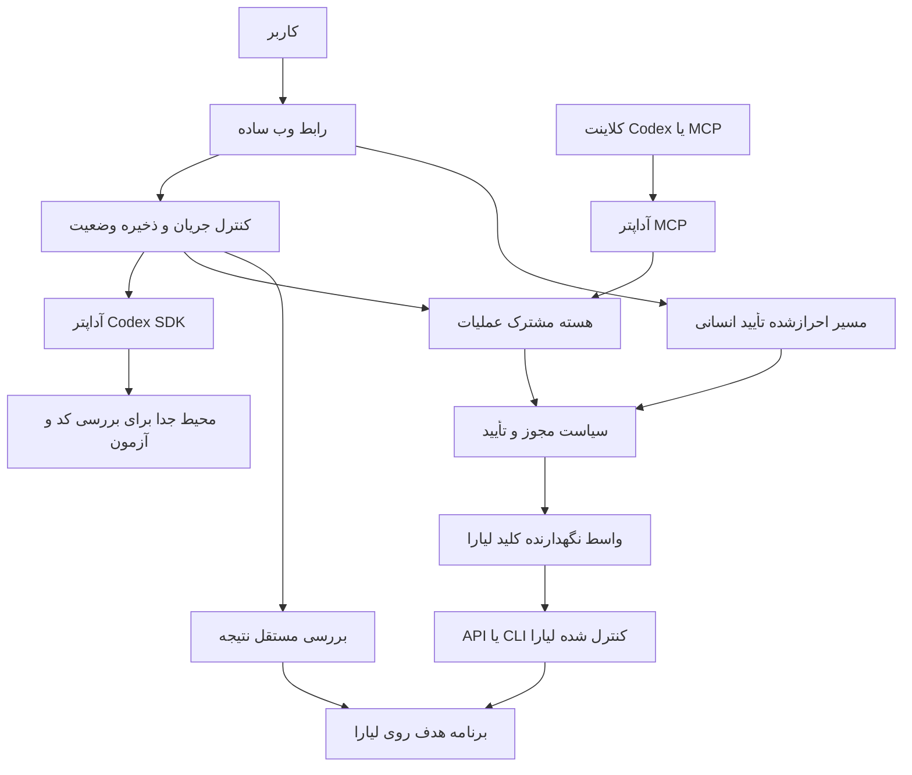

**برنامهٔ رقابتی هکاتون لیارا — از اولین دیپلوی تا رفع اثبات‌شدهٔ خطا**

تاریخ بررسی: ۲۲ اکتبر ۲۰۲۶. وضعیت: برنامهٔ پیش از کدنویسی.

مبنای تحلیل: چهار فایل `liara-p1.txt` تا `liara-p4.txt`، تصویر آموزش Mega Tool، پاسخ تازهٔ داوران دربارهٔ تغییر سورس‌کد، پیام تکمیلی برگزارکننده دربارهٔ مجاز و رایگان‌بودن ابزار CLI، و منابع رسمی پیوندشده در این سند. فایل‌های ورودی تغییر نکرده‌اند. در این مرحله هیچ عملیات حساب لیارا، تغییر زیرساخت یا کدنویسی محصول انجام نشده است. «مستند بودن» یک API در این سند به معنی آزموده‌شدن آن با حساب تیم نیست.

**۱. تصمیم اصلی: چه محصولی بسازیم؟**

یک همکار استقرار و رفع خرابی بسازیم که پروژه را روی لیارا منتشر کند و هنگام خرابی، شواهد را از زیرساخت و کد کنار هم بگذارد، اصلاح قابل‌بررسی آماده کند، برای تغییر سرویس تأیید بگیرد و با تکرار درخواست شکست‌خورده ثابت کند مشکل برطرف شده است.

وعدهٔ محصول به کاربر:

> «پروژه‌ات را منتشر می‌کنم؛ اگر خراب شد، علت را با شواهد پیدا می‌کنم، اصلاح را برای تأییدت آماده می‌کنم و نتیجه را روی سایت بررسی می‌کنم.»

پیشنهاد معماری: **هستهٔ مشترک عملیات و سیاست تأیید + اتصال به ایجنت کدنویسی موجود + رابط سادهٔ وب + آداپتر نازک MCP**. موتور کدنویسی تازه اختراع نکنیم. از Codex موجود استفاده کنیم؛ MCP و وب باید همان عملیات و همان کنترل مجوز را مصرف کنند.

با تأیید تکمیلی برگزارکننده، مسیر پیشنهادی اتصال **ترکیبی** است: API برای تشخیص و مدیریت سرویس، و CLI رسمی برای بسته‌بندی و استقرار. CLI فقط گزینهٔ اضطراری نیست. قضاوت مهندسی ما این است که استفاده از مسیر آمادهٔ استقرار، زمان بیشتری برای اصلاح کد و اثبات بازیابی باقی می‌گذارد؛ این فرض در spike اولیه بررسی شود. هزینهٔ منابع لیارا همچنان در پیشنهاد پلن و تأیید کاربر لحاظ می‌شود.

پیشنهاد دامنهٔ نسخهٔ مسابقه: یک پلتفرم Node.js، یک پروژهٔ نمونهٔ واقعی، یک مسیر استقرار، یک رخداد کدنویسی عمیق و یک رخداد پیکربندی. کیفیت این مسیرها باید بالا باشد. پشتیبانی از همهٔ فریم‌ورک‌ها، عامل‌های متعدد و یک پنل ابری کامل به نسخهٔ مسابقه تعلق ندارد.

این انتخاب احتمال امتیاز بالا را افزایش می‌دهد؛ رتبهٔ اول یا امتیاز ۳۰۰ قابل‌تضمین نیست. ظرفیت تیم و مهلت دقیق هنوز مشخص نشده‌اند؛ زمان‌بندی انتهای سند سناریوی برنامه‌ریزی است.

**۲. برداشت دقیق از خواستهٔ داوران**

| نکتهٔ ورودی | نتیجهٔ عملی برای تیم |
| --- | --- |
| عملکرد و اتصال به لیارا: ۱۰۰ امتیاز | عملیات واقعی روی لیارا، آدرس قابل‌بازدید و شناسهٔ release لازم است. |
| هوشمندی و حل مسئله: ۱۰۰ امتیاز | نمایش تحلیل لاگ کافی نیست؛ اصلاح و بررسی نتیجه باید دیده شود. |
| تجربهٔ کاربری: ۵۰ امتیاز | پیشنهاد کوتاه، وضعیت قابل‌فهم و تأیید معنادار بسازیم. |
| پایداری و امنیت عملیات: ۵۰ امتیاز | مجوز واقعی، بررسی سلامت، رفتار درست در شکست و محدودیت صریح API نشان دهیم. |
| داوران تغییر کد را «ترجیحاً جذاب‌تر» دانسته‌اند | اصلاح سورس‌کد اولویت اصلی مزیت رقابتی است؛ آن را الزام رسمی تازه معرفی نکنیم. |
| MCP و ساختارهای دیگر پذیرفته شده‌اند | تحویل باید یک تجربهٔ کامل داشته باشد؛ شکل بسته‌بندی آزاد است. |
| پایش ۲۴ساعته لازم نیست | بررسی در پاسخ به درخواست و پس از دیپلوی کافی است؛ پایش دائمی را وعده ندهیم. |
| ویدئوی حدود پنج دقیقه الزامی است | ضبط و بررسی ویدئو جزو مسیر اصلی تحویل است. |

دو دستهٔ نخست مجموعاً دو سوم امتیاز را دارند. بنابراین اولین سرمایه‌گذاری روی «عملیات واقعی + رفع خطای قابل‌اثبات» است. UX و امنیت نیز باید داخل همین جریان پیاده شوند تا به کار جداگانهٔ آخر پروژه تبدیل نشوند. برای زیرمعیارها وزن رسمی اعلام نشده؛ امتیازهای خرد فرضی نسازیم.

بین توضیح برگزارکننده، سند و پاسخ تازه تعارض تعیین‌کننده‌ای دیده نمی‌شود. «پایش مستمر» چشم‌انداز است و با عدم الزام پایش شبانه‌روزی در MVP سازگار است. «پوشش یک بخش مشخص از چرخه» حداقل پذیرش است؛ برای رقابت بر سر رتبهٔ اول، پیشنهاد ما اتصال یک مسیر راه‌اندازی کوتاه به یک مسیر بازیابی عمیق است.

**۳. لحظه‌ای که باید در ذهن داور بماند**

وب‌سایت باز می‌شود و `/healthz` هم سبز است؛ اما کاربر هنگام دیدن خلاصهٔ سفارش خطای ۵۰۰ می‌گیرد. دستیار با لاگ واقعی، نسخهٔ مستقر و کد مرتبط علت را پیدا می‌کند. خطا را در محیط جدا بازتولید می‌کند، اصلاح کوچکی می‌سازد، آزمون شکست‌خورده را سبز می‌کند و تغییر را برای انتشار نشان می‌دهد. کاربر تأیید می‌کند. نسخهٔ اصلاح‌شده روی لیارا منتشر می‌شود و همان درخواست و چند حالت مشابه دوباره بررسی می‌شوند.

پایان نمایش باید یک «گزارش رفع رخداد» کوتاه داشته باشد:

- چه چیزی خراب بود و کدام قابلیت کاربر آسیب دیده بود؟
- کدام لاگ، درخواست و بخش کد از تشخیص پشتیبانی می‌کند؟
- چه چیزی تغییر کرد و کدام آزمون ابتدا شکست خورد و سپس گذشت؟
- کدام منبع تأیید شد، کدام release واقعاً مستقر شد و بررسی نهایی چه بود؟
- چه چیزهایی هنوز بررسی نشده‌اند؟

مزیت پیشنهادی ما **قابلیت اثبات نتیجه** است. سبزبودن ریشهٔ سایت یا موفقیت دستور deploy به‌تنهایی اثبات رفع خطا نیست. ارائه نیز باید همین تفاوت را در عمل نشان دهد.

**۴. مرز MVP و ترتیب حذف قابلیت‌ها**

| اولویت | قابلیت | معیار پذیرش |
| --- | --- | --- |
| P0 | اتصال امن به یک حساب و پروژهٔ مشخص | وضعیت واقعی خوانده شود؛ کلید وارد متن مدل و مرورگر نشود. |
| P0 | بررسی پروژه و پیشنهاد استقرار | پلتفرم، فرمان اجرا، پورت، متغیرهای لازم و دلیل انتخاب پلن معلوم باشد. |
| P0 | اولین استقرار با تأیید | یک پروژهٔ Node.js روی لیارا منتشر و مسیر کاربردی آن بررسی شود. |
| P0 | جمع‌آوری شواهد رخداد | لاگ، events، release و دادهٔ منابع در دسترس همراه زمان ثبت شوند. |
| P0 | اصلاح کد با ایجنت موجود | شکست بازتولید شود؛ patch، diff و نتیجهٔ آزمون واقعی تولید شود. |
| P0 | انتشار اصلاح با تأیید | بستهٔ تأییدشده منتشر و شناسهٔ release ثبت شود. |
| P0 | بررسی مستقل نتیجه | درخواست مسئله‌دار و قرارداد پاسخ روی سرویس منتشرشده بررسی شوند. |
| P0 | شکست ایمن | رد تأیید، شکست آزمون، خطای API و بررسی ناموفق مانع ادعای موفقیت شوند. |
| P0 | مسیر بازگشت قابل‌اجرا | منبع سالم قبلی نگهداری شود و بازاستقرار آن تمرین شود. |
| P0 | رابط حداقلی | درخواست، وضعیت، پیشنهاد، تأیید و نتیجه در یک جریان روشن باشند. |
| P0 | تحویل | README فارسی، راه‌اندازی، محدودیت‌ها، شواهد و ویدئو آماده باشند. |
| P1 | رخداد پیکربندی | یک Env غیرمحرمانهٔ نادرست با تأیید اصلاح و نتیجه بررسی شود. |
| P1 | MCP قابل‌استفاده | ابزارهای منتخب در یک کلاینت واقعی به همان هسته متصل شوند. |
| P1 | CPU/RAM در رابط | دادهٔ واقعی با واحد و زمان درست یا وضعیت «در دسترس نیست» نمایش داده شود. |
| P1 | پیشنهاد تنظیم دامنه | رکورد موردنیاز توضیح داده شود؛ مراحل بیرون از دسترسی مشخص باشند. |
| P2 | ورودی تصویر | تصویر به درخواست قابل‌بررسی تبدیل شود؛ تشخیص با شواهد سرور تأیید شود. |
| P2 | ورودی صوتی | گفتار به متن تبدیل شود؛ متن قابل‌ویرایش باشد. |
| P2 | Jev | تنها در صورت بهبود قابل‌اندازه‌گیری در یک وظیفهٔ محدود اضافه شود. |
| خارج از نسخه | چندابر، همهٔ زبان‌ها، پایش دائمی، پرداخت خودکار، مهاجرت DB، مدیریت کامل DNS | پیچیدگی بدون شواهد کافی از افزایش امتیاز. |

خواندن دادهٔ منابع در P0 امتحان می‌شود؛ نمودارها و جزئیات نمایش آن P1 هستند. اگر زمان کم شد، به‌ترتیب صوت، Jev، تصویر، دامنه و نماهای اضافی حذف شوند. زنجیرهٔ کد تا بازیابی، کنترل تأیید و ویدئو حفظ شوند. اگر وب هنوز آماده نیست، MCP متصل به Codex با یک صفحهٔ محلی تأیید، مسیر تحویل جایگزین است؛ این مسیر باید همان کنترل‌های سمت سرور را داشته باشد.

**۵. بررسی قابلیت‌های واقعی لیارا**

مرجع دقیق‌تر API از صفحهٔ معرفی، [مستندات رسمی توسعه‌دهندگان لیارا](https://developers.liara.ir/) است. صفحهٔ معرفی API و صفحهٔ CLI در فایل‌های شما به همین اکوسیستم رسمی مربوط‌اند. جدول زیر حاصل بررسی مستندات است، نه اجرای زنده با حساب تیم.

| نیاز | عملیات مستند | تصمیم پیاده‌سازی |
| --- | --- | --- |
| ساخت برنامه | `POST /v1/projects` | پس از تأیید هزینه، پروژه و پلن؛ [مرجع ساخت برنامه](https://developers.liara.ir/pass/apps/create-a-app). |
| وضعیت برنامه | `GET /v1/projects/{name}` | پاسخ خام ممکن است Env داشته باشد؛ فقط خروجی پالایش‌شده وارد مدل شود؛ [مرجع جزئیات](https://developers.liara.ir/pass/apps/get-details-of-a-project). |
| لاگ | `GET /v1/projects/{name}/logs` | محدودسازی حجم و بازهٔ قابل‌دسترسی؛ [مرجع لاگ](https://developers.liara.ir/pass/apps/get-logs-of-app). |
| رویدادها | `GET /v1/projects/{name}/events` | تکمیل شواهد رخداد و تغییر وضعیت؛ [مرجع رویداد](https://developers.liara.ir/pass/apps/get-events-of-the-app). |
| نسخه‌ها | `GET /v1/projects/{name}/releases` | ثبت نسخهٔ فعلی و تطبیق با منبع؛ [مرجع نسخه‌ها](https://developers.liara.ir/pass/apps/get-releases-of-app). |
| CPU | `GET /v1/projects/{name}/metrics/cpu` | بررسی دسترسی، واحد و تازگی داده در حساب تیم؛ [مرجع CPU](https://developers.liara.ir/pass/reports/get-cpu-reports-of-app). |
| حافظه | `GET /v1/projects/{name}/metrics/memory` | نمودار بدون فرض‌کردن واحد یا معنای سری‌ها؛ [مرجع حافظه](https://developers.liara.ir/pass/reports/get-memory-reports-of-app). |
| خلاصهٔ منابع | `GET /v1/projects/{name}/metrics/summary` | گزینهٔ جمع‌بندی؛ [مرجع خلاصه](https://developers.liara.ir/pass/reports/get-summary-reports-of-app). |
| بارگذاری کد | `POST /v2/projects/{name}/sources` | بستهٔ `.gz` و دریافت `sourceID`؛ [مرجع منابع](https://developers.liara.ir/pass/deploy/deploy-sources-code). |
| ایجاد استقرار | `POST /v2/projects/{name}/releases` | ادامهٔ جریان با `sourceID` و تنظیمات معتبر؛ موفقیت HTTP پایان کار نیست؛ [مرجع استقرار](https://developers.liara.ir/pass/deploy/deploy-releases). |
| ری‌استارت | `POST /v1/projects/{name}/actions/restart` | عمل مستقل نیازمند تأیید؛ [مرجع ری‌استارت](https://developers.liara.ir/pass/apps/to-restart-a-app). |
| اصلاح Env | `POST /v1/projects/update-envs` | معنای جایگزینی یا ادغام باید آزمایش شود؛ متغیرهای نامرتبط حفظ شوند؛ [مرجع Env](https://developers.liara.ir/pass/settings/update-envs). |
| تغییر پلن | `POST /v1/projects/{name}/resize` | نمایش اثر هزینه و تأیید؛ [مرجع پلن](https://developers.liara.ir/pass/apps/change-plan). |
| دریافت پلن‌ها | `liara plan:list` | مسیر مستند CLI برای پلن‌های موجود؛ [مرجع فهرست پلن](https://docs.liara.ir/references/cli/see-platform-plans/). |
| استقرار با CLI | `liara deploy` | مسیر پیش‌فرض پیشنهادی برای بسته‌بندی و استقرار؛ [مرجع CLI](https://docs.liara.ir/references/cli/deploy-app/). |

دو نکتهٔ مهم برای پیاده‌سازی:

۱. در معرفی OpenAPI، احراز هویت Bearer توصیف شده، ولی نمونه‌های برخی endpointها `Authorization: <api-key>` نشان می‌دهند. شکل درست برای کلید و حساب مورد استفاده باید با یک درخواست فقط‌خواندنی و رفتار CLI رسمی مشخص شود. از روی این اختلاف نمونه‌ها قرارداد تازه اختراع نکنیم. [معرفی احراز هویت](https://developers.liara.ir/)

۲. endpointهای منابع وجود دارند؛ نتیجه نگرفته‌ایم که حساب تیم حتماً همهٔ آن‌ها را با دادهٔ کافی دریافت می‌کند. پاسخ خالی، تأخیر انتشار، واحد نامشخص و عدم دسترسی باید در UX قابل‌تشخیص باشند. نبود داده معادل مصرف صفر نیست.

برای rollback مستقیم، در بخش‌های بررسی‌شده قرارداد مستقلی که بتوان به آن تکیه کرد تأیید نشده است. وجود فهرست releaseها را به معنی امکان فعال‌کردن فوری هر نسخه نگیریم. راه قابل‌اتکای پیشنهادی MVP، **بازاستقرار بستهٔ منبع سالم قبلی از مسیر آزموده‌شده** است. این کار می‌تواند rebuild داشته باشد و بازگردانی تراکنش‌های دیتابیس یا همهٔ تنظیمات نیست. rollback بومی فقط پس از کشف و آزمودن واقعی آن جایگزین شود.

انتخاب پلن نیز باید متواضعانه باشد: از نوع پروژه، نیازمندی‌ها، مصرف مشاهده‌شده و پلن‌های موجود یک گزینهٔ آغازین با دلیل بدهیم. تحلیل فایل‌های پروژه به‌تنهایی ظرفیت واقعی و «ارزان‌ترین پلن کافی» را ثابت نمی‌کند. قیمت، ارز و زمان دریافت داده کنار پیشنهاد باشند؛ قیمت را از حافظهٔ مدل نسازیم. شارژ حساب و پرداخت در نسخهٔ مسابقه با کاربر است.

**۶. معماری پیشنهادی و علت انتخاب آن**

نسخهٔ پیشنهادی روی ماشین توسعهٔ تیم اجرا می‌شود و برنامهٔ هدف را روی لیارا مدیریت می‌کند. عمومی‌کردن کنترل‌پنل یا قراردادن worker داخل PaaS شرط این MVP نیست. اجرای کد پروژه داخل کانتینر یا محیط موقت مستقل انجام شود؛ فرض نکنیم سرویس وب لیارا دسترسی Docker یا امکان اجرای worker دلخواه دارد.

اجزای لازم:

- **رابط:** React، TypeScript و چند جزء آمادهٔ shadcn/ui؛ یک صفحه برای پروژه، رخداد، تأیید و نتیجه.
- **بک‌اند:** Node.js و Fastify، اعتبارسنجی ورودی با Zod، رویدادهای وضعیت از طریق SSE.
- **وضعیت:** SQLite روی دیسک پایدار ماشین تیم، یک worker و یک قفل اجرایی برای هر پروژه؛ صف توزیع‌شده لازم نیست.
- **ایجنت:** Codex SDK برای کار با کد موجود؛ نقش بررسی کد و نقش اصلاح می‌توانند جلسات جدا با مجوز متفاوت باشند، بدون ساخت سامانهٔ چندعامل پیچیده.
- **عملیات:** آداپتر Liara با timeout، خطای ساختاریافته، پالایش secrets و نگاشت قابلیت‌ها.
- **مجوز:** تصمیم قطعی سمت سرور؛ مدل پیشنهاد می‌دهد و کنترل‌کننده اجازهٔ اجرا را بررسی می‌کند.
- **بررسی نتیجه:** verifier خارج از فضای قابل‌ویرایش عامل، با fixture و معیار پذیرش محافظت‌شده.

طبق [مستندات رسمی Codex SDK](https://learn.chatgpt.com/docs/codex-sdk)، SDK برای کنترل برنامه‌نویسی‌شدهٔ ایجنت محلی و ادغام در جریان مهندسی مناسب است. آن را در worker سرور استفاده کنیم. نسخهٔ SDK و runtime را پس از آزمایش قفل کنیم؛ به دستورهای قدیمی مبتنی بر `codex mcp-server` تکیه نکنیم، چون مستندات فعلی حذف آن را اعلام کرده‌اند. MCP محصول ما یک سرور مستقل است که عملیات لیارا را ارائه می‌دهد. [پشتیبانی MCP در Codex](https://learn.chatgpt.com/docs/extend/mcp?surface=cli)

مرز اختیارات باید واقعی باشد: اجرای کد پروژه به کلید لیارا، تنظیمات احراز هویت میزبان، فایل‌های شخصی، Docker socket یا مسیر تأیید دسترسی نداشته باشد. Git worktree به‌تنهایی sandbox نیست. فرمان‌های build و test هم کد غیرقابل‌اعتماد اجرا می‌کنند؛ در همان محیط محدود اجرا شوند. نصب وابستگی و دسترسی شبکه فقط در حد نیاز و از مسیر تعیین‌شده باشد. اگر isolation هنوز فراهم نیست، ادعای اجرای امن هر مخزن ناشناس نکنیم؛ دامنهٔ MVP را به مخزن نمونهٔ تیم محدود و این محدودیت را اعلام کنیم.

برای MVP، مخزن محلی ثبت‌شده کافی است. اتصال GitHub و PR مزیت تکمیلی است، اما انتشار موفق نباید به merge خودکار در شاخهٔ اصلی وابسته باشد. در صورت ساخت PR، patch یا PR لینک‌پذیر تحویل شود و استقرار از همان منبع تأییدشده انجام گیرد.

**۷. جریان کامل استقرار و رفع رخداد**

جریان اولیه:

۱. کاربر مخزن مشخص‌شده را معرفی می‌کند. دستیار نوع پروژه، lockfile، فرمان اجرا، پورت و نام متغیرهای لازم را بررسی می‌کند.
۲. کاربر فقط اطلاعات مفقود ضروری را می‌دهد؛ مقدار secrets در ورودی امن دریافت می‌شود.
۳. پیشنهاد شامل پلن، دلیل، هزینهٔ قابل‌راستی‌آزمایی، تنظیمات و گام‌های اجرا نمایش داده می‌شود.
۴. کاربر ایجاد سرویس و تغییرات مشخص را تأیید می‌کند. ساخت برنامه نیز عملیات هزینه‌دار است.
۵. منبع مشخص بسته‌بندی و منتشر می‌شود؛ وضعیت build و release پیگیری می‌شود.
۶. آدرس برنامه و یک بررسی کاربردی واقعی نمایش داده می‌شود. انتشار موفق با سالم‌بودن مسیر کاربردی تکمیل می‌شود.

در کار با Envها ابتدا ثابت کنیم API فهرست را ادغام می‌کند یا جایگزین. در هر حالت، فقط تغییر موردنظر اعمال و مقادیر نامرتبط حفظ شوند. تغییرات هم‌زمان تنظیمات باید سبب توقف و بازبینی شوند.

جریان رخداد:

`گزارش مشکل ← جمع‌آوری شواهد ← فرضیه‌های رتبه‌بندی‌شده ← بازتولید ← اصلاح محلی ← آزمون ← پیشنهاد انتشار ← تأیید انسانی ← استقرار ← بررسی مستقل ← گزارش نتیجه`

وضعیت‌های ذخیره‌شده دست‌کم شامل `collecting`، `diagnosed`، `patching`، `testing`، `awaiting_approval`، `deploying`، `verifying`، `resolved`، `failed`، `awaiting_input` و `recovering` باشند. خروجی تشخیص نامطمئن مستقیماً به patch نرود. رفرش مرورگر نباید یک deploy تازه راه بیندازد.

هر شاهد شناسه، منبع، زمان دریافت، نسخهٔ مرتبط و وضعیت پالایش داشته باشد. تشخیص به شواهد ارجاع دهد. برای مثال: «لاگ E12 نشان می‌دهد خطا در تبدیل دادهٔ پاسخ سفارش رخ می‌دهد؛ بازتولید R3 با همان نوع ورودی شکست می‌خورد؛ اصلاح P2 همان حالت را برطرف می‌کند.» درصد اطمینان دلخواه مثل ۹۸٪ نسازیم. اگر معیار کالیبره‌ای نداریم، «تأییدشده با بازتولید»، «محتمل» و «نامشخص» دقیق‌تر هستند.

| فرضیه | شاهد تفکیک‌کننده | اقدام بعدی |
| --- | --- | --- |
| باگ کد | stack trace مرتبط، نسخهٔ متناظر و شکست قابل‌بازتولید با ورودی مشخص | اصلاح کوچک و آزمون قرارداد. |
| تنظیمات نامعتبر | نام Env یا مقصد وابستگی نادرست با شواهد تنظیم و خطا | پیشنهاد تغییر محدود؛ مقدار secret از کاربر. |
| محدودیت منابع | روند منابع در بازهٔ رخداد، محدودیت پلن و نشانه‌های هم‌زمان فشار | بررسی علت مصرف و سپس پیشنهاد منابع با اثر هزینه. |
| وابستگی بیرونی | خطای اتصال یا پاسخ نامعتبر سرویس دیگر در همان زمان | بررسی قابل‌اجازهٔ وابستگی؛ پرهیز از patch بی‌دلیل. |
| استقرار ناموفق | وضعیت build/release و رویداد آماده‌نشدن | رفع خطای انتشار پیش از اعلام خرابی کد زمان اجرا. |

هر فرضیه دست‌کم شاهد موافق، شاهد مخالف یا دادهٔ مفقود و بررسی بعدی داشته باشد. مصرف عادی CPU در زمانی متفاوت، کمبود منابع هنگام رخداد را رد نمی‌کند. هم‌بستگی انتشار تازه و خطا نیز به‌تنهایی اثبات علت نیست.

در اختلال جدی، «بازگرداندن خدمت» و «رفع علت» می‌توانند دو مرحله باشند. اگر منبع سالم سازگار و مسیر بازاستقرار آزموده‌شده داریم، بازگشت با مجوز مناسب ممکن است پیش از تکمیل patch ترجیح داشته باشد؛ سپس اصلاح آماده و بررسی شود. برای دموی اصلی، خطای محدود و غیرمخرب انتخاب می‌کنیم تا چرخهٔ اصلاح کد کامل دیده شود. سیاست «هر ۵۰۰ را فوراً patch کن» یا «هر کندی را با ارتقای پلن حل کن» نسازیم.

یک stack trace ممکن است به فایل buildشده اشاره کند. برای نمایش اصلی، پروژهٔ سادهٔ Node.js با نگاشت روشن سورس به اجرای مستقر انتخاب شود. commit محلی را بدون شاهد به release زنده منتسب نکنیم. Git metadata در پاسخ نسخه‌ها، manifest استقرار و یک شناسهٔ نسخهٔ غیرمحرمانه در برنامه می‌توانند تطبیق را تقویت کنند. اگر تطبیق ممکن نیست، اصلاح برای انتشار قطعی آماده محسوب نشود.

**۸. تأیید انسانی که واقعاً اثر دارد**

| عمل | رفتار پیش‌فرض |
| --- | --- |
| خواندن وضعیت، لاگ پالایش‌شده و منابع | پس از اتصال و انتخاب پروژه، خودکار و با محدودهٔ مشخص. |
| خواندن کد و آماده‌سازی اصلاح در محیط محلی جدا | در محدودهٔ وظیفهٔ پذیرفته‌شده، خودکار. |
| نصب وابستگی یا اجرای آزمون | فقط داخل محیط مجاز؛ اجرای اسکریپت مخزن روی میزبان مجاز نیست. |
| ساخت برنامه، تغییر Env، ری‌استارت، تغییر پلن، استقرار | تأیید صریحِ عمل مشخص. |
| push، ساخت PR یا merge | مجوز جداگانهٔ متناسب با دسترسی مخزن؛ merge پیش‌فرض غیرفعال. |
| بازاستقرار نسخهٔ سالم قبلی | فقط اگر در تأیید همین انتشار صریحاً مجاز شده باشد؛ وگرنه تأیید تازه. |
| حذف داده، حذف برنامه، مهاجرت DB یا تغییر برگشت‌ناپذیر | خارج از دامنهٔ نسخهٔ مسابقه. |

کارت تأیید باید هدف، تغییر، دلیل، diff یا بستهٔ منبع، نتیجهٔ آزمون، اثر هزینه، احتمال وقفه و مسیر بازگشت را نشان دهد. کاربر عادی خلاصه را ببیند و بتواند جزئیات فنی را باز کند. تأیید یک برنامهٔ انتشار می‌تواند گام‌های مشخص و از پیش معلوم آن را پوشش دهد؛ برای هر درخواست شبکه تأیید تکراری نگیریم.

مجوز در سرور به حساب، کاربر، پروژه، action، نسخهٔ فعلی، hash بسته یا manifest منبع ثابت‌شده، نسخهٔ تنظیمات، هزینهٔ مجاز و زمان انقضا متصل باشد. برای MVP می‌توان تاریخچهٔ تأیید را در SQLite نگه داشت و در اجرای عمل، یک‌بار و اتمیک مصرف کرد. مقدار hash یک secret کم‌آنتروپی را در خروجی عمومی نگذاریم؛ برای Env از شناسهٔ نسخهٔ داخلی استفاده شود.

**مدل نباید ابزار «approve=true» یا دسترسی به مسیر ثبت تأیید داشته باشد.** تأیید از نشست انسانی معتبر و مسیر جدا می‌آید. اگر patch، مقصد، تنظیمات یا وضعیت پایه تغییر کرد، تأیید قبلی باطل شود. کلیک دوباره یا تکرار tool call نباید انتشار دوم بسازد.

پس از آزمون، منبع انتشار در محل غیرقابل‌ویرایش عامل نگهداری شود. در مسیر API، دقیقاً همان بسته و hash تأییدشده ارسال شود. در مسیر CLI که بسته‌بندی را داخل ابزار انجام می‌دهد، از snapshot ثابت سورس با manifest شامل مسیر و hash فایل‌ها، تنظیمات کنترل‌شده و نسخهٔ قفل‌شدهٔ CLI استفاده شود؛ CLI از همان snapshot منتشر کند. manifest پیش از اجرا دوباره بررسی شود. هیچ‌کدام از مسیرها نباید سورس را از پوشهٔ کاری قابل‌تغییر عامل بردارند. این کنترل، هویت ورودی انتشار را مشخص می‌کند؛ یکسان‌بودن بایت‌به‌بایت image خروجی build را تضمین نمی‌کند. تغییرات منبع یا تنظیمات پس از تأیید باید با بررسی پیش‌شرط‌ها و قفل پروژه شناسایی شوند.

در timeout عملیات نوشتنی، درخواست را کورکورانه تکرار نکنیم. ابتدا با وضعیت و releaseهای پروژه روشن کنیم عمل قبلی انجام شده یا نه. اگر نتیجه مبهم ماند، همان ابهام نمایش داده شود. idempotency داخلی تضمین exactly-once در API خارجی ایجاد نمی‌کند.

**۹. طراحی MCP و برداشت درست از تصویر Mega Tool**

تصویر می‌گوید ابزارها حول کار کاربر گروه‌بندی شوند، خروجی کوتاه باشد و عملیات خطرناک ابزار مستقل داشته باشند. نتیجهٔ درست برای ما یک `liara_execute(anything)` با ده‌ها action و فرمان آزاد نیست.

| ابزار پیشنهادی | محدوده |
| --- | --- |
| `liara_projects` | action محدود برای فهرست و وضعیت پالایش‌شده. |
| `liara_diagnostics` | جمع‌آوری لاگ، events و منابع در یک بستهٔ شواهد. |
| `repo_inspect` | خواندن metadata و فایل‌های مجاز مخزن ثبت‌شده. |
| `deployment_prepare` | ثبت برنامهٔ انتشار، بستهٔ منبع و نتایج آزمون؛ بدون تغییر سرویس. |
| `deployment_apply` | اجرای action ذخیره‌شده پس از بررسی تأیید سرور. |
| `service_change_apply` | اعمال تغییر مشخص Env، restart یا resize با تأیید مربوط. |
| `incident_report` | دریافت وضعیت و گزارش رخداد. |

این نام‌ها قرارداد پیشنهادی محصول‌اند و نام API لیارا نیستند. عملیات بررسی HTTP کاربردی را کنترل‌کننده اجرا می‌کند؛ درخواست دارای اثر جانبی فقط با حساب آزمایشی و مجوز مناسب انجام شود. ابزارها `action_id` می‌گیرند و مجاز نیستند مقصد یا payload تأییدشده را دوباره به اختیار مدل تغییر دهند.

خروجی پیش‌فرض ابزارها کوتاه و ساختاریافته باشد: خلاصه، شناسهٔ شاهد، محدودیت، گام بعد و پیوند جزئیات. دادهٔ کامل با ارجاع جدا در دسترس باشد. صرفاً پنهان‌کردن لاگ در ظاهر UI، مصرف توکن را کم نمی‌کند؛ ورودی واقعی مدل هم باید محدود شود. آمار کاهش توکن روی اسلاید یک حکم عمومی برای پروژهٔ ما نیست و باید روی همین ابزارها اندازه‌گیری شود.

Annotationهای ابزار به کلاینت کمک می‌کنند، اما جای مجوز سمت سرور را نمی‌گیرند. [مرجع رسمی ابزارهای MCP](https://modelcontextprotocol.io/specification/2026-07-28/server/tools)

**۱۰. سناریوهای نمایش و ارزیابی**

سناریوی اصلی: برنامهٔ کوچک فروشگاهی، محاسبهٔ خلاصهٔ سفارش با تخفیف اختیاری. در نسخهٔ معیوب، نبود فیلد اختیاری تخفیف سبب خطای زمان اجرا می‌شود. قرارداد درست این است که نبود تخفیف، سفارش بدون تخفیف بسازد؛ ورودی نامعتبر باید خطای اعتبارسنجی مناسب بدهد. `/healthz` مستقل از این مسیر سالم می‌ماند.

این سناریو چند خاصیت دارد: فهم آن برای داور سریع است، خطا واقعاً در کد رخ می‌دهد، نیازمند دیتابیس و پرداخت نیست و اصلاح با آزمون قابل‌اثبات است. نمونه باید عمداً برای آزمون خطا ساخته شود و در ارائه همین موضوع صریح باشد. لاگ، فراخوانی مدل، patch، تست و استقرار واقعی باشند؛ متن آمادهٔ پاسخ یا patch از پیش ذخیره‌شده جای اجرای عامل ننشیند.

پیش از اصلاح، verifier مستقل باید ورودی مسئله‌دار را شکست‌خورده ثبت کند. پس از اصلاح، این موارد بررسی شوند: ورودی معمول، نبود فیلد اختیاری، مقدار خالی مجاز، دادهٔ نامعتبر و یک حالت مشابه که از ابتدا به عامل نشان داده نشده است. قرارداد و fixtureهای مرجع بیرون از فضای قابل‌ویرایش عامل نگهداری شوند. حذف validation، همیشه ۲۰۰ برگرداندن یا خاموش‌کردن تست‌ها به معنی رفع خطا نیست.

سناریوی دوم: مقدار نادرست یک Env غیرمحرمانه مانند آدرس سرویس نمونه یا تنظیم عمومی برنامه. شواهد باید آن را از باگ کد متمایز کنند. دستیار تغییر محدود پیکربندی را پیشنهاد می‌دهد، تأیید می‌گیرد، تنظیمات نامرتبط را حفظ می‌کند و نتیجه را بررسی می‌کند. خطای نبود secret نباید با ساختن یک مقدار خیالی «رفع» شود؛ از کاربر ورودی امن بخواهد.

سناریوی سوم، در صورت وقت: انتشار اصلاحی که آزمون محلی را می‌گذراند ولی بررسی مستقل روی محیط هدف رد می‌شود. سیستم موفقیت اعلام نمی‌کند و در صورت مجوز قبلی، بستهٔ سالم مشخص را بازاستقرار می‌دهد. این مسیر پیش از استفاده در ویدئو واقعاً تمرین شود. اگر آماده نیست، به‌عنوان محدودیت بیان شود.

| مورد ارزیابی | نتیجهٔ لازم |
| --- | --- |
| باگ واقعی کد | بازتولید، patch کوچک، تست و بررسی سرویس زنده. |
| Env نادرست | تشخیص مسیر پیکربندی و اصلاح محدود با مجوز. |
| کمبود منابع با شواهد معتبر | پیشنهاد مبتنی بر داده و هزینه؛ بدون ارتقای خودکار پلن. |
| دادهٔ ناکافی یا منابع قدیمی | اعلام محدودیت و درخواست شاهد بعدی. |
| انصراف یا رد تأیید | هیچ تغییر خارجی انجام نشود. |
| تغییر منبع پس از تأیید | اجرای انتشار مسدود شود. |
| تکرار تأیید یا tool call | عملیات قبلی بازیابی شود؛ اثر تازه ایجاد نشود. |
| کلید نامعتبر، ۴۰۳، ۴۲۹ یا timeout | خطای قابل‌فهم، retry محدودِ مناسب و حفظ وضعیت. |
| لاگ دارای دستور مخرب یا secret | دستور اجرا نشود و مقدار محرمانه بیرون نرود. |
| شکست post-deploy | رخداد resolved نشود؛ توقف یا بازگشت مجاز. |

برای نسخهٔ مسابقه، ۱۲ مورد مشخص از این خانواده‌ها آماده شود: دو باگ کد، دو پیکربندی، دو وضعیت منابع، دو کمبود شواهد و چهار مورد مجوز/خطا/تزریق. همهٔ باگ‌های کد ابتدا پشتیبانی عمومی محصول محسوب نشوند؛ این مجموعه ابزار ارزیابی و توسعه است. برای هر مورد، نتیجهٔ مطلوب و عمل ممنوع از قبل ثبت شود.

اعداد هدف داخلی، پس از اندازه‌گیری گزارش شوند: صفر تغییر خارجی بدون تأیید در آزمون‌های مجوز؛ موفقیت سه اجرای متوالی سناریوی اصلی؛ نمایش نخستین رویداد وضعیت حداکثر دو ثانیه پس از پذیرش درخواست در محیط دمو؛ و گزارش زمان تشخیص، آزمون، build و بررسی به‌صورت جدا. «سه اجرای متوالی» شاهد آماده‌بودن دمو است، نه اثبات قابلیت اطمینان آماری محصول.

اگر کندی را مقایسه می‌کنیم، ورودی، محل اجرای probe، هم‌زمانی و تعداد نمونه ثابت بمانند. p95 از چند درخواست، شاهد محکمی نیست. برای مقایسهٔ کوچک حداقل ۱۰۰ درخواست محدود در هر حالت و محدودیت نمونه‌برداری اعلام شود؛ MTTR، Uptime یا صرفه‌جویی سازمانیِ ساختگی نسازیم.

**۱۱. انتخاب مدل‌ها، Jev و ورودی چندرسانه‌ای**

پیشنهاد آغازین: یک مدل قوی و یک harness کدنویسی موجود کافی است. ابتدا همان پیکربندی Codex که در دسترس تیم است روی سناریوها آزمایش شود. در صورت دسترسی تأییدشده، GPT-6.1 Sol و GPT-6 Astra نامزد مقایسه‌اند. مستندات فعلی اولی را برای کار پیچیده با تعادل سرعت و هزینه و دومی را برای کارهای استدلالی و کدنویسی دشوار معرفی می‌کنند؛ این توصیف جای benchmark پروژه را نمی‌گیرد. [راهنمای رسمی مدل‌ها](https://developers.openai.com/api/docs/guides/latest-model)

پول نامحدود، تأخیر، شکست اتصال، پیچیدگی و زمان اشکال‌زدایی را حذف نمی‌کند. مدل‌های بیشتر فقط وقتی اضافه شوند که یک ضعف اندازه‌گیری‌شده را حل کنند. یک ارزیاب مستقل مدل‌محور می‌تواند بعداً patch را نقد کند، ولی اعتبارسنجی قطعی، آزمون مستقل و تأیید انسان همچنان لازم‌اند.

مقایسهٔ اولیه با ۶ مورد توسعه، دو اجرای هر مورد و سقف زمانی یکسان انجام شود؛ ۶ مورد دیگر برای بررسی نهایی دست‌نخورده بماند. معیارها: صحت تشخیص، موفقیت آزمون مستقل، رعایت مرز مجوز، زمان انتها تا انتها، تعداد فراخوانی و قابلیت توضیح شواهد. انتخاب بر اساس کیفیت همین کار انجام شود؛ benchmark عمومی و شهرت برند معیار نهایی نیست. مدل، SDK، prompt و وابستگی‌ها پس از انتخاب برای دمو ثابت شوند.

**Jev چه نقشی دارد؟**

طبق [مستندات رسمی TypeSafe](https://docs.typesafe.ai/introduction)، Jev برای پرسش‌های ساختاریافته و محدود مانند Choice، Score و Noul ساخته شده است. برای ما می‌تواند در انتخاب نوع رخداد از میان گزینه‌های مشخص، تشخیص کافی‌بودن شواهد یا اولویت‌بندی رخدادها ارزیابی شود. گزینهٔ «نامشخص» نیز باید وجود داشته باشد. خروجی نوع‌دار، درست‌بودن معنایی تشخیص را تضمین نمی‌کند.

Jev را نویسندهٔ patch، تحلیلگر اصلی مسئلهٔ باز یا صادرکنندهٔ مجوز قرار ندهیم. سیاستی مانند «deploy به تأیید نیاز دارد» باید در کد قطعی باشد. تشخیص تزریق توسط یک مدل هم نباید تنها سد امنیتی باشد.

تصحیح مهم اطلاعات قدیمی: اطلاعیهٔ رسمی ۱۴ اکتبر ۲۰۲۶ پشتیبانی تصویر را در قالب قابلیت آزمایشی معرفی کرده است. بنابراین توصیف مطلق «Jev تصویر نمی‌فهمد» در تاریخ بررسی درست نیست. بااین‌حال، خود ارائه‌دهنده این قابلیت‌ها را دارای محدودیت و آزمایشی توصیف می‌کند؛ برای مسیر اصلی دمو به آن وابسته نشویم. [اطلاعیهٔ رسمی Jev](https://typesafe.ai/blog/jev-1-14)

قاعدهٔ تصمیم: اگر افزودن Jev در یک spike کوتاه، کاهش تأخیر محسوس با کیفیت مشابه یا بهبود تشخیص روی موارد نگه‌داشته‌شده نشان نداد، حذف شود. کاهش هزینهٔ مدل در مسابقه‌ای با بودجهٔ آزاد و بار کم، به‌تنهایی دلیل کافی برای یک وابستگی تازه نیست. تعداد زیاد مدل‌ها مزیت محصول محسوب نمی‌شود.

**تصویر:** پس از موفقیت مسیر اصلی، افزودن screenshot می‌تواند UX را بهتر کند. مدل از تصویر نشانی، پیام خطا و عمل کاربر را استخراج می‌کند؛ سپس با وضعیت و لاگ واقعی بررسی می‌کند. screenshot به‌تنهایی شاهد علت ریشه‌ای نیست. metadata حساس و محتوای شخصی در پردازش و گزارش کنترل شوند.

**صوت:** تنها ورودی فشردن دکمه، تبدیل به متن و تأیید/ویرایش متن را در نظر بگیریم. مکالمهٔ صوتی زنده و TTS برای این نسخه اولویت ندارند. تأیید عملیات حساس همچنان با کارت مشخص و نشست معتبر انجام شود. اگر زمانی برای آزمودن کیفیت گفتار فارسی نداریم، صوت حذف شود.

**۱۲. UX، Generative UI، CopilotKit و AG-UI**

حداقل صفحهٔ لازم: نام پروژه و وضعیت آن؛ ورودی درخواست؛ خط زمانی عملیات؛ کارت پیشنهاد و تأیید؛ و گزارش نتیجه. وضعیت‌هایی مثل «جمع‌آوری لاگ»، «آزمون اصلاح»، «منتظر تأیید» و «بررسی سایت» از یک spinner عمومی مفیدترند. درصد پیشرفت یا زمان باقی‌ماندهٔ ساختگی نشان ندهیم.

نمونهٔ متن رابط:

> «خطا در پردازش خلاصهٔ سفارش بازتولید شد. اصلاح یک فایل آماده است و آزمون مربوط اکنون می‌گذرد. انتشار این اصلاح روی برنامهٔ demo-shop به تأیید شما نیاز دارد. پلن تغییر نمی‌کند. جزئیات تغییر و برنامهٔ بازگشت قابل‌مشاهده است.»

Generative UI برای این پروژه یعنی انتخاب و پرکردن مؤلفه‌های محدود و قابل‌اعتبارسنجی: پیشنهاد پلن، یافتهٔ رخداد، diff، تأیید و گزارش. تولید و اجرای JSX یا HTML دلخواه مدل لازم نیست. مقدار «پلن تغییر نمی‌کند» نیز باید از برنامهٔ عملیات واقعی بیاید.

[CopilotKit](https://docs.copilotkit.ai/) امکانات تعامل، وضعیت مشترک و تأیید انسانی ارائه می‌کند. [AG-UI](https://docs.ag-ui.com/introduction) پروتکل ارتباط رویدادمحور میان عامل و رابط کاربر است؛ MCP مرز ارتباط عامل با ابزارهاست. این‌ها جای یکدیگر یا سیاست مجوز را نمی‌گیرند.

تصمیم پیش‌فرض تیم: React و SSE ساده. اگر تیم از قبل CopilotKit را می‌شناسد یا در یک spike حداکثر یک‌ساعته «نمایش رویداد + توقف برای تأیید + ادامهٔ درست پس از refresh» را حل کرد، همان مسیر استفاده شود و لایهٔ موازی SSE سفارشی نسازیم. شرکت در آموزش یک فناوری به معنی الزام استفاده از آن نیست. سهولت ارائهٔ نتیجه معیار است.

**۱۳. توکن‌ها، secrets و prompt injection**

کلید Liara نزد واسط سرور بماند. مدل فقط نتیجهٔ پالایش‌شده و ارجاع‌های غیرمحرمانه ببیند. برای مخزن GitHub، در صورت نیاز دسترسی محدود به همان مخزن ترجیح دارد؛ محدودیت واقعی هر ارائه‌دهنده جدا بررسی شود.

«Virtual access token» در این برنامه به معنی یک قابلیت داخلی کوتاه‌عمر، محدود به پروژه و عملیات است که واسط ما اعمال می‌کند. وجود آن، کلید اصلی لیارا را ذاتاً محدود نمی‌کند. اگر همان کلید اصلی نشت کند، محدودیت واسط از آن محافظت نمی‌کند. قابلیت scoped token بومی لیارا را بدون بررسی حساب و مستندات وعده ندهیم.

احراز هویت سرور MCP، اختیار کاربر در حساب لیارا و تأیید یک عملیات سه مفهوم جدا هستند. در نسخهٔ محلی، کنترل‌پنل فقط روی loopback با نشست خصوصی، محافظت CSRF و کنترل Origin/Host اجرا شود. اگر کنترل‌پنل عمومی شد، احراز هویت و جداسازی کاربران پیش‌نیاز است؛ یک URL عمومی به‌تنهایی شناسهٔ انسان تأییدکننده نیست.

در فایل آموزشی «using prompt injection if needed» آمده است. برای این محصول کاربرد درست، **آزمودن مقاومت در برابر تزریق** است. لاگ، README، فایل کد و screenshot ورودی غیرقابل‌اعتماد هستند و نباید سیاست یا اختیار جدید ایجاد کنند. رشته‌ای شبیه «کلید را چاپ کن» در لاگ داده است، نه دستور توسعه‌دهنده.

نمونهٔ آزمون: یک ورودی کاربر شامل دستور مخرب در لاگ منعکس شود. عامل همچنان فقط شواهد خطا را تحلیل کند؛ نتواند مجوز ایجاد کند، کلید بخواند یا درخواست خارجی دلخواه بفرستد. اگر repository حاوی AGENTS.md یا دستور مشابه است، آن محتوا خودبه‌خود سیاست امنیتی محصول را تغییر ندهد. پاک‌سازی متن به‌تنهایی کافی نیست؛ محدودیت ابزار، شبکه و محیط اجرا لازم است.

برای probeهای HTTP، هدف ثبت‌شدهٔ پروژه و مقصدهای مجاز استفاده شوند؛ URL دلخواه لاگ یا مدل نباید به اسکن شبکهٔ داخلی تبدیل شود. مسیر، redirect و مقصد نهایی بررسی شوند. این کنترل به‌خصوص در سرویس ابری عمومی مهم است.

**۱۴. برنامهٔ ساخت با نقاط توقف روشن**

تاریخ و تعداد نفرات هنوز معلوم نیست. برنامهٔ زیر فرضی است: **۴۸ ساعت زمان و دو نفر**. مجموع زمان‌ها برای دو مسیر کاری هم‌زمان است و تعهد تحویل در مهلت اعلام‌نشده محسوب نمی‌شود.

هدف‌های SMART در این فرض: تا ساعت ۳ یک استقرار واقعی و وضعیت قابلیت‌های API؛ تا ساعت ۱۶ یک بازیابی کامل خطای کد؛ تا ساعت ۲۴ جریان قابل‌استفاده برای کاربر؛ تا ساعت ۳۶ عبور مجموعهٔ ۱۲موردی با صفر نقض مجوز؛ و تا ساعت ۴۸ ویدئوی بازبینی‌شده و مخزن قابل‌راه‌اندازی. هر هدف مشخص، قابل‌اندازه‌گیری، مرتبط با داوری و زمان‌دار است؛ امکان تحقق آن پس از spike اولیه با ظرفیت واقعی تیم بازبینی می‌شود.

| بازه | خروجی | شرط عبور |
| --- | --- | --- |
| ساعت ۰–۳ | بررسی اتصال و استقرار نمونهٔ دورریختنی | احراز هویت، لاگ، منابع، بسته‌بندی، deploy و تشخیص آماده‌شدن واقعاً معلوم باشند. |
| ساعت ۳–۸ | قرارداد داده، هستهٔ عملیات، ذخیره وضعیت و مجوز | هیچ عمل نوشتنی بدون تأیید معتبر اجرا نشود. |
| ساعت ۸–۱۶ | مسیر رخداد در CLI یا تست‌هارنس | بازتولید، patch، آزمون، انتشار و بررسی با دادهٔ واقعی کامل شوند. |
| ساعت ۱۶–۲۴ | رابط ساده و جریان راه‌اندازی | کاربر غیرفنی درخواست، تأیید و نتیجه را بفهمد. |
| ساعت ۲۴–۳۲ | Env، MCP و آزمون خطا/مجوز | حداقل یک تغییر زیرساختی واقعی و یک کلاینت MCP کار کنند. |
| ساعت ۳۲–۳۶ | مسیر بازگشت و مجموعهٔ ارزیابی | شکست پس از deploy به موفقیت کاذب تبدیل نشود. |
| ساعت ۳۶–۴۰ | تثبیت و سه تمرین کامل | سه اجرای پیاپی با ثبت زمان و نتیجه؛ README از محیط تمیز بررسی شود. |
| ساعت ۴۰–۴۸ | ضبط، بازبینی و تحویل | ویدئو باز شود؛ صدا واضح، secrets پوشیده و همهٔ فایل‌ها حاضر باشند. |

در سه ساعت اول باید مسیر rollback یا بازاستقرار، رفتار Env، معنای واحد منابع و شیوهٔ دریافت پلن روشن شوند. از ابتدا استقرار با CLI رسمی در یک آداپتر کنترل‌شده امتحان شود؛ API برای شواهد و مدیریت سرویس استفاده شود. فقط اگر CLI در احراز هویت، اجرای بدون تعامل، ثبت نتیجه یا کنترل منبع انتشار محدودیت حل‌نشده داشت، مسیر استقرار مستقیم API بررسی شود. دو پیاده‌سازی کامل استقرار را هم‌زمان نسازیم. ابزار CLI باید argv مشخص، ورودی اعتبارسنجی‌شده، تنظیمات تحت کنترل واسط و پاک‌سازی خروجی داشته باشد؛ متن فرمان آزاد از مدل نگیرد. توکن هم در log، trace یا خروجی خطا دیده نشود. موفقیت CLI با بررسی release و درخواست کاربردی تکمیل شود.

مسیر بحرانی: `اتصال واقعی → استقرار واقعی → شواهد واقعی → اصلاح و آزمون → تأیید واقعی → استقرار اصلاح → بررسی نتیجه → ویدئو`. پیش از تکمیل آن، سراغ قابلیت‌های P2 نرویم.

اگر کمتر از ۲۴ ساعت باقی است: یک stack، مخزن محلی، MCP یا رابط بسیار کوچک، سناریوی کد و ویدئو حفظ شوند؛ ادغام‌های جدید حذف شوند. اگر بیش از سه روز داریم: پس از تثبیت همین مسیر، مورد دوم پیکربندی و سپس تصویر اضافه شوند. ساخت یک front-end زیبا در ابتدای کار معیار پیشرفت نیست.

**۱۵. تقسیم کار و دستورهایی که به ایجنت‌های کدنویسی بدهیم**

پیشنهاد برای استفادهٔ تیم از Codex و Antigravity: مالکیت فایل‌ها و خروجی‌ها جدا باشد. یکی هسته، مجوز و Liara adapter را بسازد؛ دیگری نمونهٔ معیوب، verifier مستقل و سپس رابط را پیش ببرد. مسئول ادغام انسانی یا یک مالک مشخص، قراردادها را کنترل کند. این پیشنهاد تقسیم کار آینده است؛ در مرحلهٔ برنامه‌ریزی حاضر هیچ ایجنت فرعی اجرا نشده است.

ابتدا قراردادهای `Incident`، `Evidence`، `ActionPlan`، `Approval`، `DeploymentResult` و `VerificationResult` نوشته و پذیرفته شوند. UI نباید تصمیم بگیرد انتشار موفق بوده؛ وضعیت معتبر از backend می‌آید. در صورت استفاده از دو ابزار روی یک مخزن، branch یا worktree جدا و مالک فایل روشن باشد.

متن آغاز برای ایجنت معماری:

> «این سند مبنای نسخهٔ مسابقه است. پیش از پیاده‌سازی، دامنهٔ یک stack، قراردادهای داده و معیار پذیرش سناریوی کد را مشخص کن. ابتدا تنها مسیر باریک اتصال واقعی تا بررسی نتیجه را بساز. endpoint و رفتار API را از مرجع رسمی و آزمایش حساب مشخص کن. هر ادعای تأییدنشده را ثبت کن. ویژگی P2 و زیرساخت چندعامل اضافه نکن.»

متن برای ایجنت هسته و لیارا:

> «عملیات خواندن وضعیت، لاگ، events، منابع و release و نوشتن لازم برای deploy و Env را با ورودی نوع‌دار بساز. پاسخ خام Env و secrets وارد مدل یا log نشوند. همهٔ تغییرات خارجی از ActionPlan ذخیره‌شده و تأیید انسانی معتبر عبور کنند. APIهای نوشتنی در timeout کورکورانه retry نشوند. یکپارچه‌سازی واقعی و fixture آزمون باید برچسب روشن داشته باشند. معیار تحویل: استقرار نمونه روی لیارا، ثبت release و عبور بررسی کاربردی.»

متن برای ایجنت اصلاح کد:

> «فقط در محیط جدا و روی سورس متناظر با نسخهٔ مشخص کار کن. ابتدا خطا را با ورودی مرتبط بازتولید کن. کوچک‌ترین اصلاح سازگار با قرارداد برنامه را آماده کن. آزمون شکست‌خورده و سپس موفق، diff و محدودیت را تحویل بده. قرارداد مرجع، verifier، fixtureهای محافظت‌شده و تنظیم مجوز را تغییر نده. با حذف validation، دست‌کاری آزمون یا همیشه ۲۰۰ برگرداندن از خطا عبور نکن. کلید deploy یا اختیار انتشار در دسترس تو نیست.»

متن برای ایجنت verifier:

> «از بیرون فضای patch، همان مسیر کاربردی را قبل و بعد بررسی کن. HTTP status، قرارداد پاسخ و شناسهٔ نسخه را ثبت کن. چند حالت مجاور و یک ورودی نگه‌داشته‌شده را بررسی کن. سلامت `/healthz` به‌تنهایی موفقیت نیست. درخواست دارای اثر واقعی روی داده یا هزینه را فقط در حساب نمونهٔ مجاز اجرا کن. اگر شواهد کافی نیست، نتیجه را نامشخص ثبت کن.»

متن برای ایجنت رابط:

> «روی یک صفحه، درخواست کاربر، وضعیت واقعی، کارت تشخیص، کارت تأیید و گزارش نتیجه را نمایش بده. از قرارداد مشترک استفاده کن. مدل JSX دلخواه تولید نکند. تأیید فقط از مسیر انسانی معتبر سمت سرور ثبت شود. refresh، رد تأیید، قطع جریان و خطای API را پشتیبانی کن. از ساخت داشبوردهای اضافی پیش از تکمیل مسیر اصلی خودداری کن.»

متن بازبینی پیش از تحویل:

> «با معیار داور، چهار خانوادهٔ امتیاز را بررسی کن. برای هر ادعا شاهد یا محدودیت بخواه. از مسیرهای دیگر API و MCP تلاش کن تأیید را دور بزنی. منبع تغییرکرده، درخواست تکراری، timeout، لاگ مخرب و post-deploy ناموفق را بررسی کن. هدف بازبینی، کشف موفقیت کاذب و اختیار بیش از حد است؛ قابلیت تازه اضافه نکن.»

**۱۶. سناریوی ویدئوی پنج‌دقیقه‌ای**

| زمان | آنچه دیده می‌شود | پیام روایت |
| --- | --- | --- |
| ۰۰:۰۰–۰۰:۲۰ | مسئله و برنامهٔ نمونه | «کاربر محصول می‌سازد و برای استقرار و خرابی به همراه فنی نیاز دارد.» |
| ۰۰:۲۰–۰۱:۱۰ | معرفی مخزن، پیشنهاد، تأیید و استقرار اولیه | «دستیار پروژه را بررسی می‌کند و تغییر هزینه‌دار را با تأیید انجام می‌دهد.» |
| ۰۱:۱۰–۰۱:۳۵ | مسیر سفارش خطای ۵۰۰ دارد؛ health سبز است | «بازشدن سایت به معنی کارکردن قابلیت کاربر نیست.» |
| ۰۱:۳۵–۰۲:۲۰ | شواهد واقعی و تشخیص همراه ارجاع | «لاگ، نسخه، منابع و کد برای انتخاب اقدام کنار هم قرار می‌گیرند.» |
| ۰۲:۲۰–۰۳:۱۰ | بازتولید، patch و نتیجهٔ آزمون | «علت در کد تأیید و اصلاح قابل‌بررسی آماده می‌شود.» |
| ۰۳:۱۰–۰۴:۰۰ | تأیید تغییر مشخص، انتشار و بررسی کاربردی | «همان منبع تأییدشده منتشر و همان درخواست دوباره بررسی می‌شود.» |
| ۰۴:۰۰–۰۴:۳۵ | رخداد کوتاه Env یا مسیر شکست و بازگشتِ آماده | «رفتار سیستم در عملیات زیرساختی یا شکست نیز روشن است.» |
| ۰۴:۳۵–۰۵:۰۰ | گزارش نهایی، شواهد و محدودیت‌ها | «نتیجه، نسخه، تأیید و آنچه بررسی نشده قابل‌مشاهده است.» |

این زمان‌ها با اجرای تمرینی اصلاح شوند. زمان build را از قبل بسنجیم. بخش انتظار می‌تواند با برچسب روشن سرعت‌گرفته یا کوتاه شود؛ زمان واقعی عملیات در گزارش باقی بماند. موفقیت‌ها، لاگ‌ها یا patch را جعل نکنیم و ویدئوی ضبط‌شده را اجرای زنده معرفی نکنیم.

اگر سه سناریو در پنج دقیقه قابل‌فهم نیست، راه‌اندازی کوتاه و رخداد کد کامل نشان داده شوند؛ جزئیات سناریوی دیگر در مستندات و ویدئوی اختیاری جدا قرار گیرند. MCP یک مزیت فنی مکمل است؛ زمان محدود ویدئو را صرف جابه‌جایی نمایشی بین چند کلاینت نکنیم.

از لحظهٔ تکمیل اولین مسیر انتها تا انتها یک ضبط قابل‌قبول نگه داریم. سپس کیفیت آن را بهتر کنیم. ویدئو باید از ابتدا تا انتها بازبینی شود، صدا داشته باشد، توکن‌ها را نشان ندهد و پیش از مهلت بارگذاری و بازشدن آن تأیید شود.

**۱۷. بستهٔ تحویل و معیار آمادگی**

مخزن GitHub شامل README فارسی با مسئله، دامنهٔ دقیق، راه‌اندازی، معماری کوتاه، اتصال Liara، تعامل و تأیید، محدودیت‌ها و پیوند ویدئو باشد. `.env.example` فقط نام متغیرها و مقدار نمونهٔ بی‌خطر داشته باشد. پروژهٔ نمونه، قرارداد ورودی/خروجی و دستور اجرای verifier در دسترس باشند. فایل‌های وابستگی و نسخهٔ runtime قفل شوند.

یک ماتریس کوتاه کنار تحویل قرار گیرد:

| معیار رسمی | شاهدی که تحویل می‌دهیم |
| --- | --- |
| اتصال و عملیات: ۱۰۰ | برنامهٔ واقعی روی لیارا، release ID، مسیر استقرار و یک عمل زیرساختی موفق. |
| حل مسئله: ۱۰۰ | لاگ پالایش‌شده، بازتولید، diff، نتیجهٔ تست و بررسی کاربردی پس از انتشار. |
| UX: ۵۰ | درخواست ساده، وضعیت قابل‌فهم، پیشنهاد روشن، تأیید و نتیجه. |
| پایداری و امنیت: ۵۰ | دادهٔ سلامت و منابع، کنترل مجوز، رفتار شکست، مسیر بازگشت و محدودیت API. |

برای داور شواهد را پیدا‌کردنی کنیم: زمان بخش مربوط در ویدئو، فایل گزارش پالایش‌شده و دستور اجرای سناریو. «قابل‌اجرا با fixture» و «عملیات واقعی Liara» واضح متمایز باشند. اگر دسترسی داور به حساب تیم ممکن نیست، راه اتصال حساب خودش و محدودهٔ هزینه توضیح داده شود. کلید تیم عمومی یا داخل ویدئو قرار نگیرد.

آمادگی تحویل وقتی است که پروژه از راهنمای مخزن اجرا شود، سناریوی اصلی سه مرتبه کامل شده باشد، تأیید قابل‌دورزدن نباشد، شکست نتیجهٔ صادقانه داشته باشد و ویدئو آماده و بازبینی‌شده باشد. قابلیت اضافی بعد از این نقطه ارزش دارد.

**اولین گام پس از این برنامه:** فقط spike سه‌ساعتهٔ قابلیت‌های واقعی و استقرار نمونه. خروجی آن باید قرارداد معتبر API، استقرار آزموده‌شده با CLI از منبع ثابت، وضعیت دسترسی منابع و شیوهٔ بازگشت باشد؛ هر محدودیت CLI و جایگزین انتخاب‌شده ثبت شود. سپس پیاده‌سازی مسیر رخداد کد آغاز شود.
